<p align="center">
  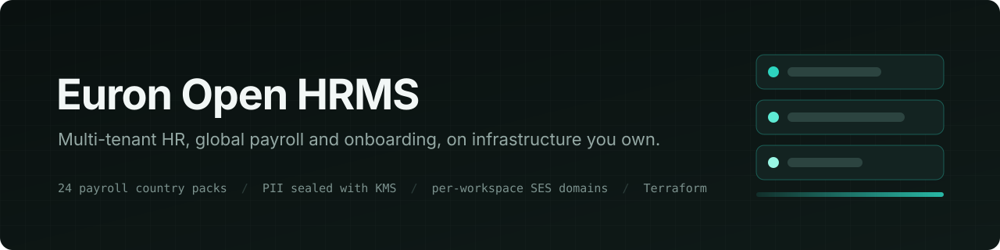
</p>

<p align="center">
  
  <a href="LICENSE"></a>
  
  
  
  
  
  
</p>

<p align="center">
  <a href="https://github.com/euron-sde-team/euron-open-hrms/stargazers"></a>
  <a href="https://github.com/euron-sde-team/euron-open-hrms/fork"></a>
  <a href="https://github.com/euron-sde-team/euron-open-hrms/watchers"></a>
  <br>
  <a href="https://github.com/euron-sde-team/euron-open-hrms/issues"></a>
  <a href="https://github.com/euron-sde-team/euron-open-hrms/pulls"></a>
  <a href="https://github.com/euron-sde-team/euron-open-hrms/commits/main"></a>
  
</p>

<p align="center">
  <b><a href="#-quickstart">Quickstart</a></b> ·
  <b><a href="#️-architecture">Architecture</a></b> ·
  <b><a href="#-explore-the-repository">Explore the repo</a></b> ·
  <b><a href="docs/api/openapi.yaml">API reference</a></b> ·
  <b><a href="#️-deploy-to-aws">Deploy</a></b> ·
  <b><a href="docs/architecture/security.md">Security</a></b> ·
  <b><a href="#-documentation">Docs</a></b>
</p>

**Euron Open HRMS** is an open-source, MIT-licensed human resources platform, part of the
open-source initiative of **ENGAGESPHERE TECHNOLOGY PRIVATE LIMITED**. One deployment serves
many companies ("workspaces"). Each gets employee records, attendance, leave, payroll for its
country, self-onboarding, documents and letters, exits, performance and an employee
self-service portal. Platform operators run the fleet from a separate console.

It is built to hold the most sensitive data a company has, so isolation and protection
are structural rather than conventions:

- Every database query is scoped to the caller's workspace by the repository layer.
- National ID numbers and bank details are encrypted with a per-workspace key wrapped by KMS.
- Each workspace can send its mail from its own verified domain through SES.

The whole stack runs on a laptop against an AWS emulator, and deploys to AWS with one
command from the same Terraform.

<p align="center">
  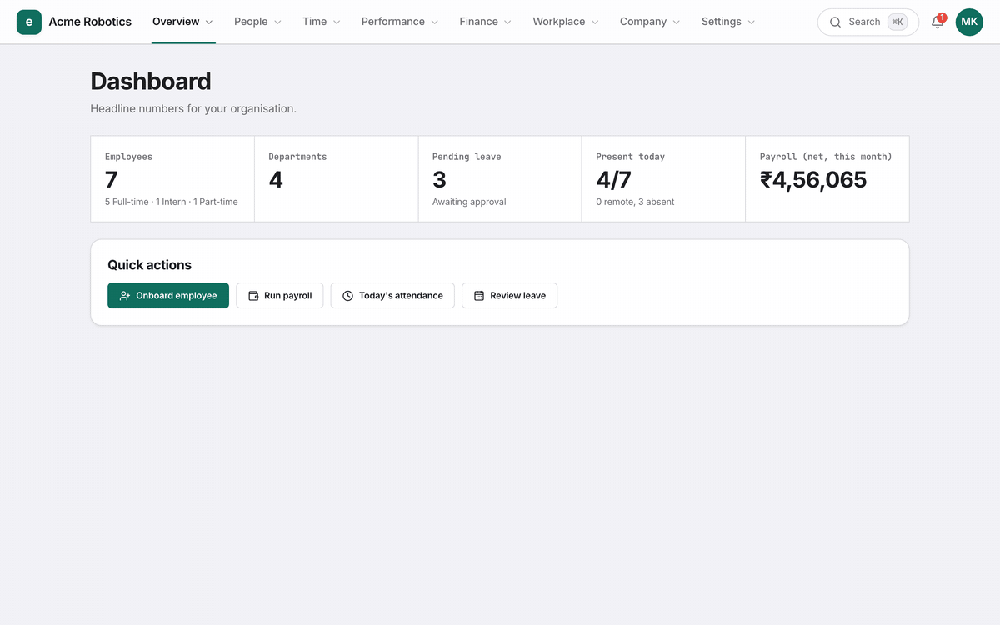
</p>

> [!NOTE]
> Everything in the tour ran for real: Docker Compose on a laptop, with S3, KMS, Secrets
> Manager, Route53 and SES emulated locally and provisioned by the same Terraform modules
> that build production. `make up && make demo` reproduces it.

---

## 📚 Table of contents

- [Why Euron Open HRMS](#-why-euron-open-hrms)
- [At a glance](#-at-a-glance)
- [Screenshots](#️-screenshots)
- [Features](#-features)
- [Architecture](#️-architecture)
  - [Life of a request](#life-of-a-request)
  - [Workspaces and data protection](#workspaces-and-data-protection)
  - [Mail from each workspace's own domain](#mail-from-each-workspaces-own-domain)
- [Tech stack](#-tech-stack)
- [Prerequisites](#-prerequisites)
- [Quickstart](#-quickstart)
- [Explore the repository](#-explore-the-repository)
- [API](#-api)
- [Configuration](#️-configuration)
- [Deploy to AWS](#️-deploy-to-aws)
- [Security model](#-security-model)
- [Testing](#-testing)
- [Documentation](#-documentation)
- [Roadmap](#️-roadmap)
- [FAQ](#-faq)
- [Contributing, security and license](#-contributing-security-and-license)

---

## 💡 Why Euron Open HRMS

HR software is where a company keeps salaries, national ID numbers, bank accounts, medical
leave and exit records. Hosted HR suites ask you to trust a black box with all of it.
Spreadsheets give that data to whoever opens the file. Euron Open HRMS is the third
option: a complete, modern HRMS you run yourself, with the security engineering visible
in the code.

- **Multi-tenant from the ground up.** Run it for one company or offer it to hundreds. Each
  workspace is isolated by the data layer itself, and a test sweeps every endpoint to prove it.
- **Payroll for the countries you hire in.** 24 built-in country packs with statutory rules,
  plus a generic engine that makes 119 countries selectable.
- **Production-grade on AWS in one command.** The Terraform builds the whole stack: VPC, RDS,
  KMS, SES, ECS Fargate, CloudFront and WAF, alarms. The same modules provision the local emulator.
- **Readable by design.** A layered API (routes, controllers, services, repositories), strict
  TypeScript, and comments that explain *why*.

## 📊 At a glance

| | |
| --- | --- |
| **Apps** | Tenant web app, operator console, API with an in-process job worker |
| **Domains** | People, time, leave, payroll, onboarding, documents, letters, exits, performance, workplace, company content |
| **Payroll** | 24 country packs (India, US and UK in depth), 119 selectable countries |
| **Isolation** | Workspace scoping in the repository layer, per-workspace KMS data keys, per-workspace SES domains |
| **Infrastructure** | 12 Terraform modules, 3 environments (local emulator, AWS dev, AWS prod) |
| **Tests** | 758 unit, 394 integration (run under 12 backend combinations), 11 browser end-to-end |
| **License** | MIT |

## 🖼️ Screenshots

<table>
  <tr>
    <td width="50%">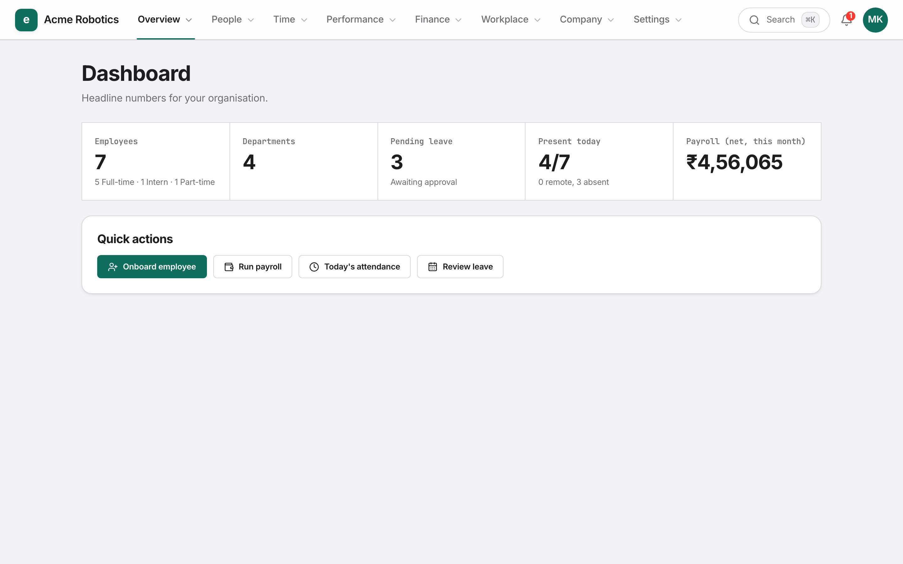<br><sub><b>Dashboard.</b> Headcount, pending approvals, today's attendance and this month's payroll.</sub></td>
    <td width="50%">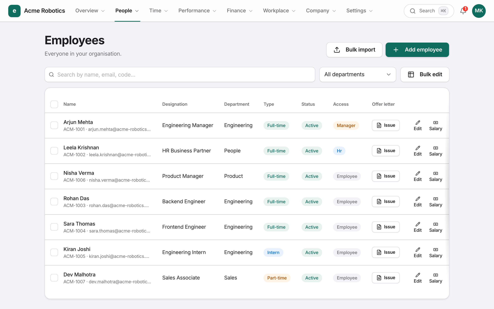<br><sub><b>Employees.</b> Roster with bulk edit, spreadsheet import and per-person access.</sub></td>
  </tr>
  <tr>
    <td>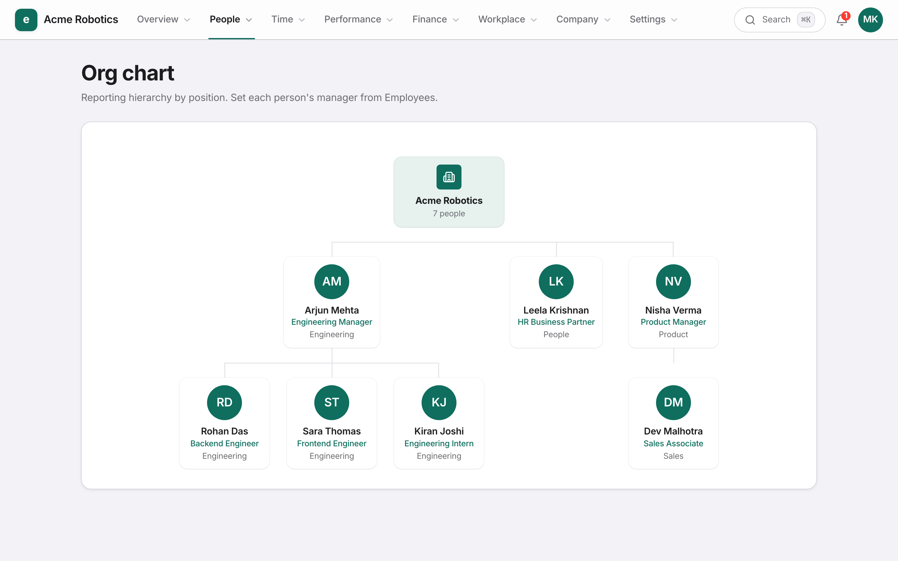<br><sub><b>Org chart.</b> Reporting lines, kept consistent across every write path.</sub></td>
    <td>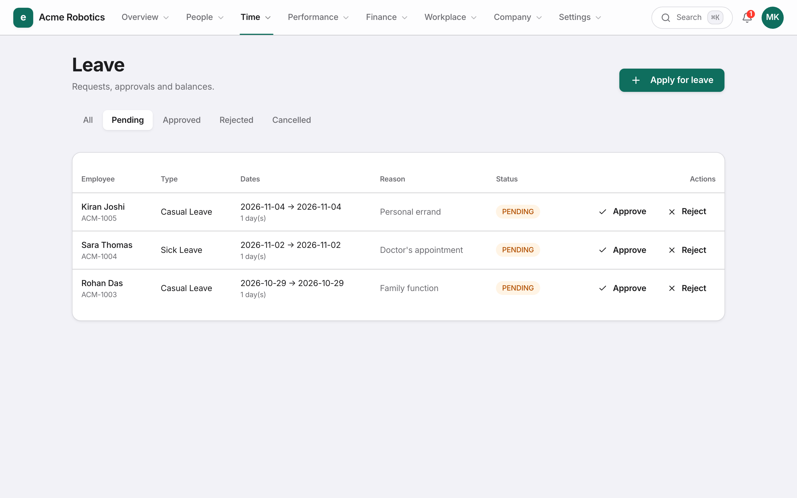<br><sub><b>Leave.</b> Requests, approvals, balances and company leave rules.</sub></td>
  </tr>
  <tr>
    <td>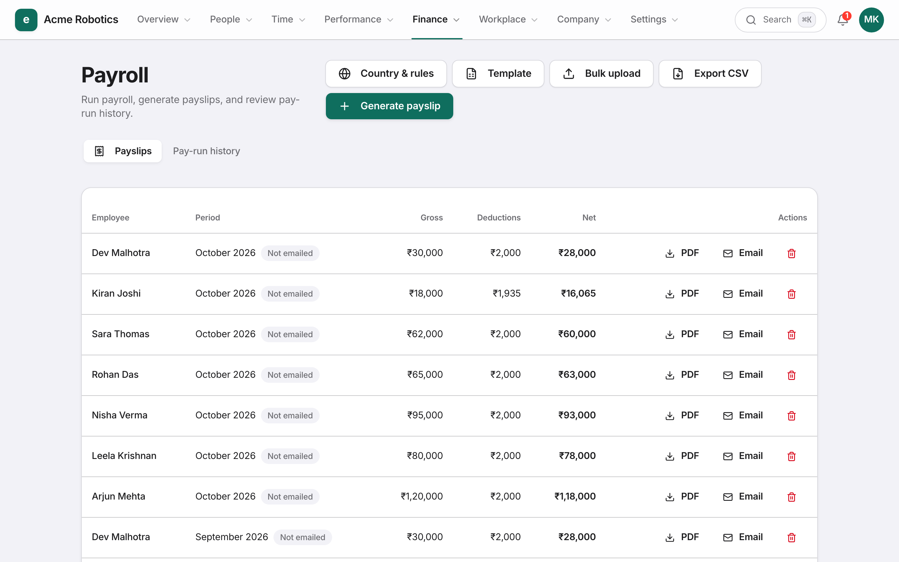<br><sub><b>Payroll.</b> Payslips from the country rule pack, as PDFs with a QR code.</sub></td>
    <td>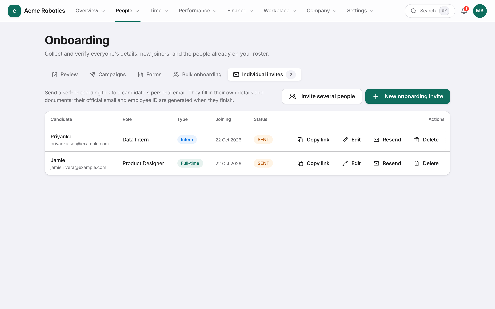<br><sub><b>Onboarding.</b> Invites, forms, campaigns, reminders and review.</sub></td>
  </tr>
  <tr>
    <td>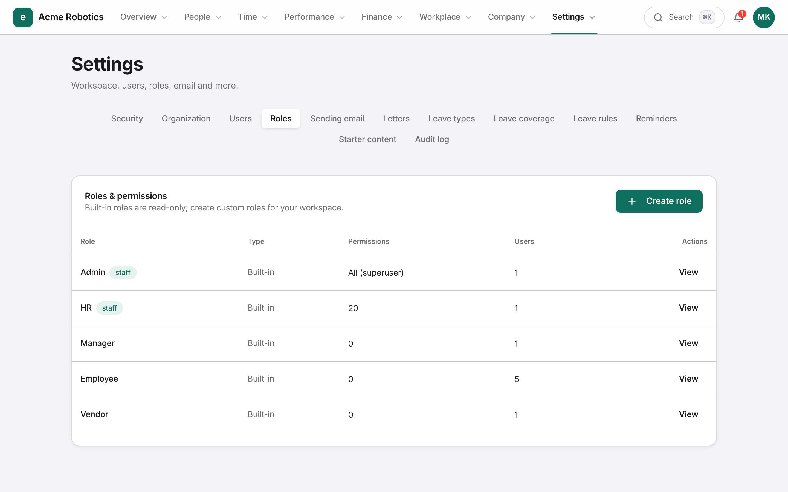<br><sub><b>Roles.</b> Built-in and custom roles, permission by permission.</sub></td>
    <td>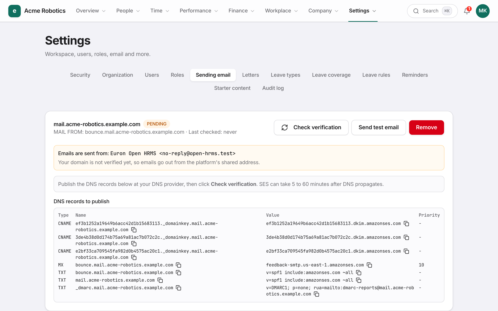<br><sub><b>Sending domain.</b> Each workspace verifies its own domain in SES.</sub></td>
  </tr>
  <tr>
    <td>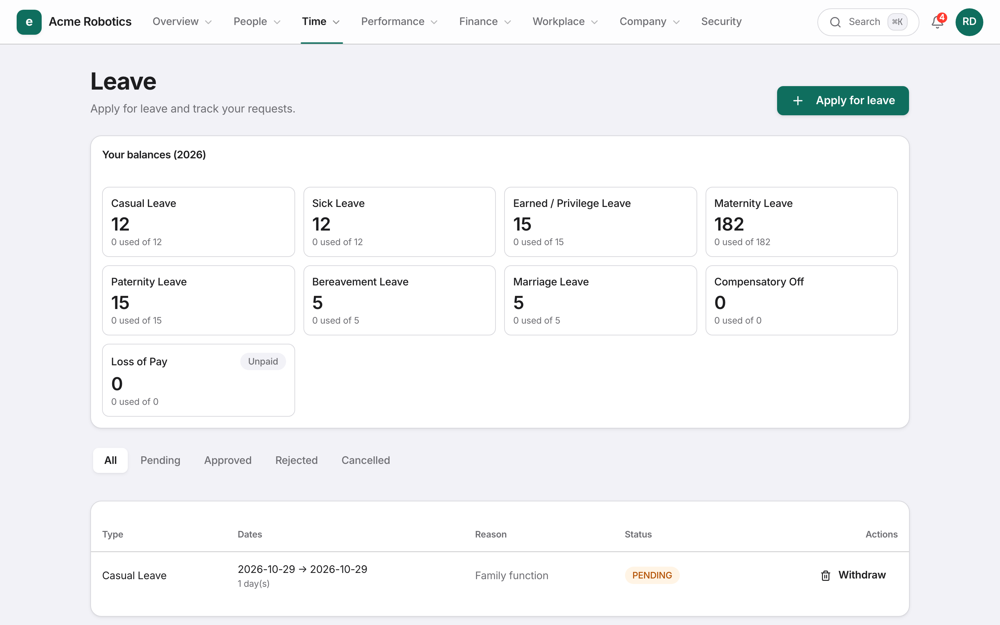<br><sub><b>Employee view.</b> Self-service balances, requests, payslips and documents.</sub></td>
    <td>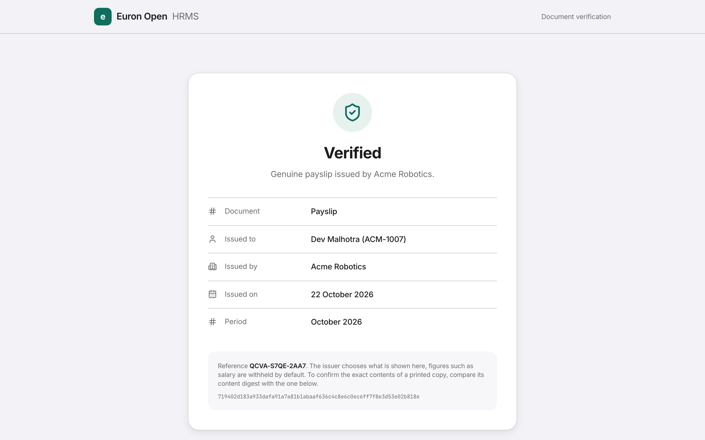<br><sub><b>Verification.</b> Anyone holding a payslip can check it is genuine.</sub></td>
  </tr>
  <tr>
    <td>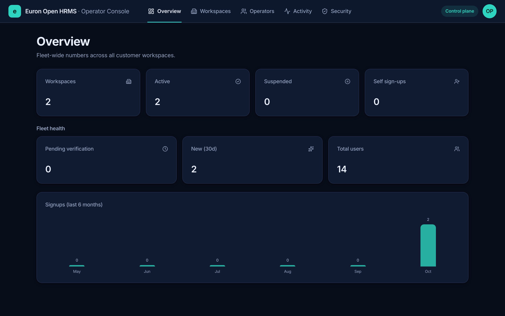<br><sub><b>Operator console.</b> Fleet metrics across every workspace.</sub></td>
    <td>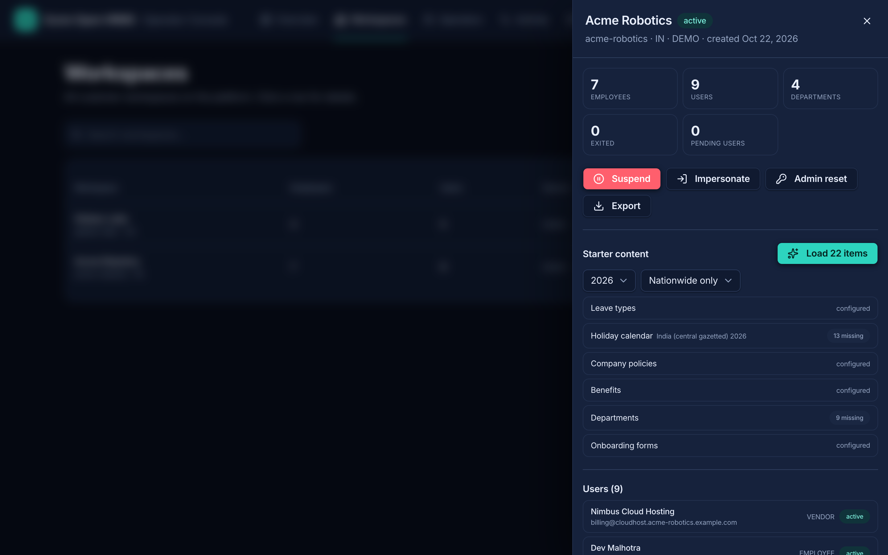<br><sub><b>Workspace detail.</b> Users, activity, starter content, suspend, impersonate (audited).</sub></td>
  </tr>
</table>

## ✨ Features

| Area | What you get |
| --- | --- |
| **People** | Employee records with KYC, bank and statutory details (sealed at rest); departments, offices with geofences, reporting lines, org chart, directory; bulk edit; spreadsheet import with preview, validation and error report |
| **Access** | Built-in roles (admin, HR, manager, employee, vendor), custom roles from a permission catalogue, several roles per user, department or office scope, TOTP two-factor with trusted devices, lockout, operator impersonation with a visible banner |
| **Time** | Geofenced check-in and check-out, attendance reports, daily clock-in reminders in each workspace's timezone |
| **Leave** | Leave types and balances, configurable rules (monthly allowances, carry-over, minimum coverage per department), approvals by reporting line, holiday calendars transcribed from official gazettes |
| **Payroll** | Country rule packs, salary structures with CTC conventions, professional tax, gratuity, exit pay proration, salary-sheet import, payslip PDFs with QR verification, pay-run history, emailed payslips |
| **Onboarding** | Candidate self-onboarding by emailed link, configurable forms and presets, campaigns for existing staff, deadline reminders and escalation, HR review section by section, optional AI extraction from identity documents |
| **Documents and letters** | Document vault with categories and visibility, letter templates with tokens, offer, confirmation, probation, relieving and appraisal letters, every issued document verifiable by QR |
| **Exits** | Resignation, termination, absconding and retirement flows, notice periods, full-and-final settlement, automatic access revocation |
| **Performance and workplace** | PIPs, appraisal cycles, work logs, wellbeing pulse, assets with custody, perks, family benefits, AI-tool allowances |
| **Company** | Announcements, policies, benefits, weekly people report to configurable recipients |
| **Mail** | Transactional mail through SES (or SMTP, or a local outbox); each workspace can verify its own sending domain with DKIM |
| **Operators** | Fleet metrics, workspace lifecycle (create, suspend, reactivate, export, purge with crypto-shredding), operator accounts with TOTP two-factor and SUPPORT (read-only) roles, audit feed |

## 🏗️ Architecture

<p align="center">
  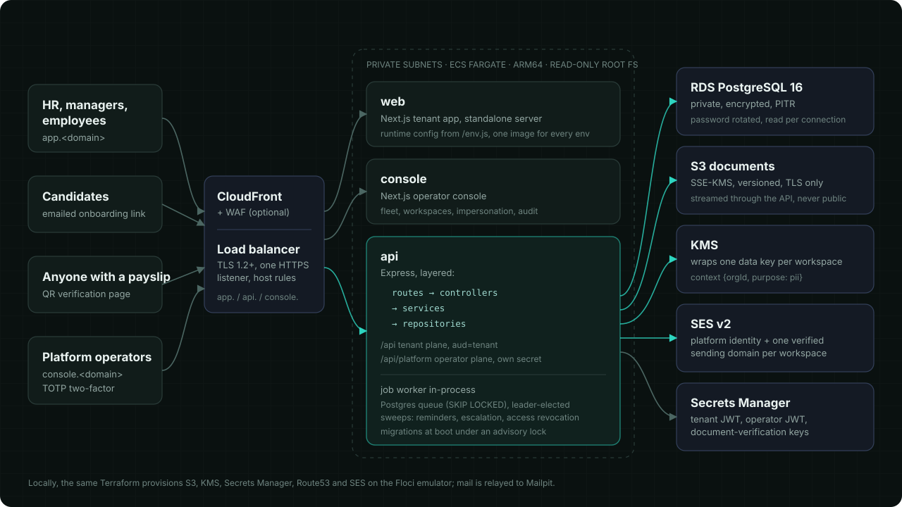
</p>

Three containers run on ECS Fargate behind one Application Load Balancer, which routes by
host name:

- **web** (`app.<domain>`): the tenant app for HR, managers and employees.
- **console** (`console.<domain>`): the operator console.
- **api** (`api.<domain>`): serves two planes. The tenant plane, `/api`, uses tenant sessions.
  The operator plane, `/api/platform`, uses operator sessions signed with a different secret
  and audience.

The API also runs the background job worker. It is a Postgres queue (`FOR UPDATE SKIP LOCKED`)
plus sweeps elected by advisory lock, so any number of replicas can run without a separate
broker. [HLD](docs/architecture/HLD.md) · [LLD](docs/architecture/LLD.md)

### Life of a request

<p align="center">
  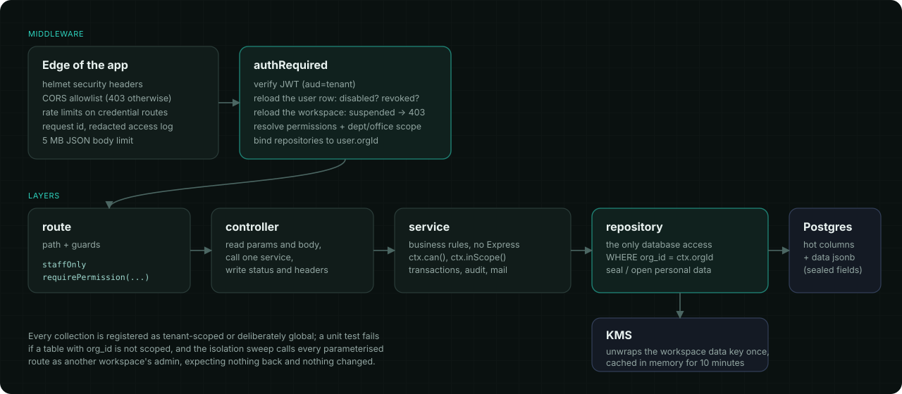
</p>

Authentication runs on every request, not only at sign-in. The user row and the workspace
are both reloaded each time, so a disabled user or a suspended workspace is locked out on
its very next call. The API then flows through four layers, each with one job:

| Layer | Folder | Job |
| --- | --- | --- |
| Routes | `apps/api/src/routes/` | URL and guards, nothing else |
| Controllers | `apps/api/src/controllers/` | Read the request, call one service, write the response |
| Services | `apps/api/src/services/` | Business rules, transactions, audit, mail. No Express |
| Repositories | `apps/api/src/repositories/` | The only database access. Workspace scoping and data sealing live here |

### Workspaces and data protection

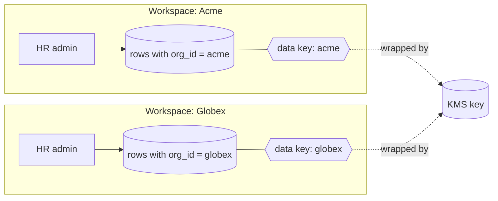

- **Isolation.** Every collection is registered as workspace-scoped (or deliberately
  global), and the repository adds `org_id = <caller's workspace>` to every query. A unit
  test fails if a table with `org_id` is left unscoped. An integration sweep reads the route
  inventory from source, then calls every parameterised route as one workspace's admin
  against the other's records. It asserts nothing leaks and not one row changes.
- **Personal data.** National ID numbers, tax IDs, bank details and onboarding answers are
  sealed with AES-256-GCM before they reach Postgres. Each workspace has its own data key,
  wrapped by KMS with `EncryptionContext {orgId, purpose: pii}`. The additional data binds
  each ciphertext to its table, workspace, row and field. Purging a workspace destroys its
  key, which makes its sealed data unreadable in old backups too.

Read more: [multi-tenancy](docs/architecture/multi-tenancy.md) ·
[security](docs/architecture/security.md) · [threat model](docs/architecture/threat-model.md)

### Mail from each workspace's own domain

<p align="center">
  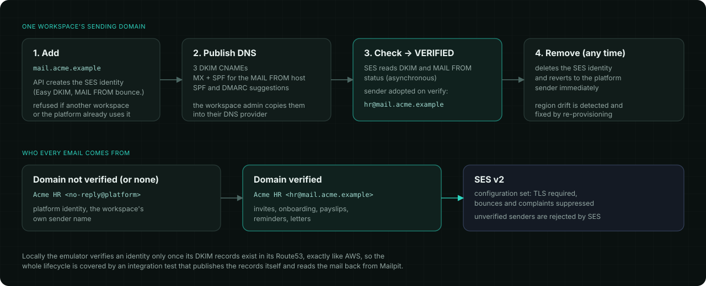
</p>

A workspace admin adds a domain, and the API creates its SES identity with Easy DKIM and a
custom MAIL FROM subdomain. Once the admin publishes the DNS records and SES verifies them,
every invitation, payslip and reminder from that workspace goes out from its own domain.
Until then, mail goes out from the platform address under the workspace's name.

- **Ownership.** A domain belongs to one workspace only, and the platform's own domain is
  reserved, because SES identities are account-wide.
- **Delivery policy.** Workspace identities share the platform's configuration set: TLS
  required, bounces and complaints suppressed.
- **Testing.** The whole lifecycle is tested against the emulator, which, like AWS, verifies
  an identity only once its DKIM records exist.
  [Guide](docs/guides/sending-domains.md)

## 🧰 Tech stack

| Layer | Choice | Why |
| --- | --- | --- |
| API | Node.js 22, Express, TypeScript (strict) | One runtime across the stack; a small, well-understood HTTP core |
| Data | PostgreSQL 16, Kysely, plain SQL migrations | Hot columns for queries, `jsonb` for evolving HR records ([ADR 0001](docs/architecture/adr/0001-hot-columns-and-jsonb.md)) |
| Jobs | Postgres queue, `SKIP LOCKED`, advisory-lock leaders | No broker to run; transactional with the data it acts on ([ADR 0003](docs/architecture/adr/0003-postgres-as-the-job-queue.md)) |
| Web and console | Next.js 15, React 19, Tailwind 4, TanStack Query | Shared UI and API-client packages; one image per app for every environment |
| PDFs | pdfkit, QR codes | Payslips and letters rendered server-side, verifiable by QR |
| AWS | ECS Fargate (ARM64), ALB, CloudFront, WAF, RDS, S3, KMS, SES v2, Secrets Manager, CloudWatch | Managed building blocks, least-privilege roles |
| Infrastructure as code | Terraform | The same modules build AWS and the local emulator ([ADR 0007](docs/architecture/adr/0007-floci-for-local-aws.md)) |
| Local AWS | Floci emulator, Mailpit | Full AWS fidelity on a laptop, mail you can read in a browser |
| Tests | Vitest, Playwright | Unit, integration against real Postgres and emulated AWS, browser end-to-end |

## 📋 Prerequisites

| Tool | Version | Used for |
| --- | --- | --- |
| [Docker](https://docs.docker.com/get-docker/) with Compose v2 | 24+ | The local stack (about 6 GB of images) |
| [Node.js](https://nodejs.org/) | 22 LTS | Building and testing outside Docker |
| [pnpm](https://pnpm.io/) | 9 (`corepack enable`) | The workspace package manager |
| [Terraform](https://developer.hashicorp.com/terraform/install) | 1.10+ | Only for deploying to AWS (local runs use a pinned container) |
| [AWS CLI](https://aws.amazon.com/cli/) | 2 | Only for deploying to AWS |

Free local ports (each overridable in `deploy/compose/.env`): 3410 (web), 3420 (console),
5005 (API), 5442 (Postgres), 8025 and 1025 (Mailpit), 4576 (AWS emulator).

## 🚀 Quickstart

```bash
git clone https://github.com/euron-sde-team/euron-open-hrms.git
cd euron-open-hrms

make up      # build and start everything; Terraform provisions the AWS emulator first
make demo    # two demo workspaces and an operator account; prints the logins
```

| Open | As |
| --- | --- |
| http://localhost:3410 | `maya.kapoor@acme-robotics.example.com` (HR admin of Acme Robotics), or `rohan.das@acme-robotics.example.com` (an employee) |
| http://localhost:3420 | `operator@example.com` (operator console) |
| http://localhost:8025 | Every email the stack sends, delivered through the emulated SES |

The password for every demo account is printed by `make demo` (it is generated by `make env`
and stored in `deploy/compose/.env`). `make down` stops everything and deletes the data.

[Full local guide](docs/guides/quickstart-local.md) ·
[Run locally against real AWS](docs/guides/local-with-aws.md) ·
[Troubleshooting](docs/guides/troubleshooting.md)

## 🧭 Explore the repository

```text
euron-open-hrms/
├── apps/
│   ├── api/                 Express API: tenant plane, operator plane, job worker
│   │   └── src/
│   │       ├── routes/          URL + guards, one file per resource
│   │       ├── controllers/     request in, response out
│   │       ├── services/        business rules and orchestration
│   │       ├── repositories/    data access; base.repository.ts scopes and seals
│   │       ├── domain/          pure rules: payroll engine, leave rules, onboarding forms, letters
│   │       ├── integrations/    SES and SMTP mail, sending domains, S3, push, AI extraction
│   │       ├── security/        RBAC, TOTP, tokens, document verification, PII encryption
│   │       ├── middleware/      authentication and guards
│   │       ├── jobs/            Postgres queue, handlers, reminders, sweeps
│   │       └── core/            config and boot guards, errors, logging, request context
│   ├── web/                 Next.js tenant app
│   └── console/             Next.js operator console
├── packages/
│   ├── ui/                  shared components and design tokens
│   ├── api-client/          HTTP client, runtime config, impersonation hand-off
│   └── types/               API types shared by both apps
├── db/                      SQL migrations and the checksummed runner
├── infra/
│   ├── terraform/           modules + envs (local-floci, aws-dev, aws-prod)
│   └── docker/              api, web and console images
├── deploy/compose/          the local stack (Floci or real AWS overlay)
├── e2e/                     Playwright browser tests
├── docs/                    architecture, ADRs, guides, OpenAPI
└── scripts/                 deploy, test matrix, OpenAPI generator, sanitization check
```

**Where to start reading:**

| To understand | Read |
| --- | --- |
| How a request is handled end to end | `routes/departments.routes.ts` → `controllers/department.controller.ts` → `services/department.service.ts` → `repositories/department.repository.ts` |
| How workspaces are isolated | `repositories/base.repository.ts`, then `test/integration/isolation.int.test.ts` |
| How personal data is encrypted | `security/pii.ts`, then `test/unit/security.test.ts` |
| How payroll is computed | `domain/payroll/engine.ts` and `domain/payroll/countries/` |
| How sending domains work | `services/sending-domain.service.ts`, `integrations/mail/ses-domains.ts`, `test/integration/sending-domains.int.test.ts` |
| How it deploys | `infra/terraform/modules/deployment/main.tf`, then `scripts/aws-deploy.sh` |

All paths above are under `apps/api/src/` or `apps/api/` unless they start with `infra/` or
`scripts/`. The [walkthrough](docs/guides/walkthrough.md) follows one employee from invitation
to first payslip through the code.

## 🔌 API

The [OpenAPI reference](docs/api/openapi.yaml) is generated from the route files themselves
(`pnpm openapi`), so it cannot drift from the code. CI fails if it does. Every operation lists
its plane, path parameters and the permission it requires.

```bash
# sign in, then call the API with the session token
TOKEN=$(curl -s localhost:5005/api/auth/login -H 'content-type: application/json' \
  -d '{"email":"maya.kapoor@acme-robotics.example.com","password":"<demo password>"}' | jq -r .token)
curl -s localhost:5005/api/employees -H "authorization: Bearer $TOKEN" | jq '.[0]'
```

## ⚙️ Configuration

The API reads its configuration from the environment. Production refuses to boot unless all
of these hold:

- the three signing secrets are long, distinct and not the development defaults
- CORS names its origins
- personal data has a real key (KMS, or a 32-byte master key)
- mail is really delivered (SES or SMTP, not the local outbox)
- links point at a real domain
- files go to S3

The web app and console read `API_URL` and `PRODUCT_NAME` at runtime from `/env.js`, so one
image serves every environment. Every variable is documented in the
[configuration reference](docs/guides/configuration.md).

## ☁️ Deploy to AWS

```bash
cp infra/terraform/envs/aws-dev/terraform.tfvars.example infra/terraform/envs/aws-dev/terraform.tfvars
# set name_prefix, domain and route53_zone_id

make aws-deploy ENV=aws-dev                       # registries, images, infrastructure, rollout
make aws-operator ENV=aws-dev EMAIL=you@example.com   # the first operator account
```

`aws-deploy` runs four steps:

1. Create the image registries.
2. Build and push the API, web and console images for ARM64, tagged with the git commit.
3. Apply the rest of the infrastructure.
4. Wait for the three services to stabilise.

Migrations run when the API boots, under an advisory lock. With a Route53 zone, the
certificates, DNS records and SES domain records are created automatically. Without one,
the outputs list exactly what to publish.

| | aws-dev | aws-prod |
| --- | --- | --- |
| Availability zones | 2, one NAT | 3, NAT per zone |
| Database | single-AZ, 3-day backups | Multi-AZ, 14-day backups, deletion protection |
| Edge | load balancer | CloudFront + WAF in front, load balancer reachable only from CloudFront |
| Scaling | API 1 to 2, web 1 to 2 | API 2 to 6, web 2 to 6 |
| Logs | 14 days | 365 days, KMS-encrypted |

[Deployment guide](docs/guides/deploy-aws.md) · [Operations runbook](docs/guides/operations.md)

## 🔐 Security model

| Concern | How it is handled |
| --- | --- |
| Workspace isolation | Repository-level scoping on every query, a registry test, and an isolation sweep across every route |
| Personal data at rest | AES-256-GCM per field, per-workspace data keys wrapped by KMS, crypto-shredding on purge |
| Sessions | Tenant and operator planes with separate secrets and audiences, 7-day tenant sessions, revocation on password change, per-request user and workspace checks |
| Sign-in | bcrypt (cost 12), password policy, lockout after repeated failures, TOTP two-factor for workspace users and operators |
| Authorisation | Permission catalogue, custom roles, department and office scope, enforced in the API (the UI only hides) |
| Documents | Every payslip and letter carries an HMAC-signed QR code; anyone can verify, nobody can forge |
| HTTP | Security headers, CORS allowlist, rate limits on credential routes, no internal detail in 500s, tokens redacted from logs |
| Infrastructure | Private subnets, TLS-only private bucket, KMS everywhere, least-privilege task roles, checkov with no unexplained exceptions |

Report vulnerabilities privately: see [SECURITY.md](SECURITY.md).

## 🧪 Testing

| Suite | What it proves | Run |
| --- | --- | --- |
| Unit (758) | Payroll packs, leave rules, onboarding forms, RBAC, PII sealing, config guards, frontend logic | `make test` |
| Integration (394) | The real API in-process against Postgres: every surface, RBAC, isolation sweep, two-factor, suspension, sending domains, onboarding, imports | `make test-integration` |
| Option matrix (12 runs) | The integration suite under every combination of storage (disk, S3), mail (outbox, SMTP, SES) and keys (local, KMS) | `make test-matrix` |
| Browser (11) | Sign-up through the emailed link, sign-in, payslip verification, candidate onboarding, operator suspension and impersonation | `make e2e` |
| Infrastructure | `terraform validate` (3 environments), tflint, checkov, shellcheck | `make tf-validate tf-lint tf-security` |

[Testing guide](docs/guides/testing.md)

## 📖 Documentation

| Architecture | Guides |
| --- | --- |
| [High-level design](docs/architecture/HLD.md) | [Quickstart (local)](docs/guides/quickstart-local.md) |
| [Low-level design](docs/architecture/LLD.md) | [Local against real AWS](docs/guides/local-with-aws.md) |
| [Multi-tenancy](docs/architecture/multi-tenancy.md) | [Deploy to AWS](docs/guides/deploy-aws.md) |
| [Data model](docs/architecture/data-model.md) | [Configuration reference](docs/guides/configuration.md) |
| [Security](docs/architecture/security.md) | [Operations runbook](docs/guides/operations.md) |
| [Threat model](docs/architecture/threat-model.md) | [Sending domains](docs/guides/sending-domains.md) |
| [Payroll engine](docs/architecture/payroll-engine.md) | [Custom roles](docs/guides/custom-roles.md) |
| [Decision records](docs/architecture/adr/) | [Testing](docs/guides/testing.md) · [Troubleshooting](docs/guides/troubleshooting.md) |
| [API reference (OpenAPI)](docs/api/openapi.yaml) | [Code walkthrough](docs/guides/walkthrough.md) |

## 🗺️ Roadmap

- Postgres row-level security as a second isolation layer under the repository scoping
- Typed request and response schemas in the OpenAPI reference
- SSO (SAML and OIDC) for workspaces
- More country packs, contributed through the [country pack guide](docs/architecture/payroll-engine.md)
- Typed route handlers (the API is strict except for implicit `any` on Express handlers)

Have an idea? [Open a feature request](https://github.com/euron-sde-team/euron-open-hrms/issues/new/choose).

## ❓ FAQ

<details>
<summary><b>Can I run it for a single company?</b></summary>

Yes. Create one workspace and never create another. The operator console is still useful for
support access and exports.
</details>

<details>
<summary><b>Do I need an AWS account to try it?</b></summary>

No. `make up` runs S3, KMS, Secrets Manager, Route53 and SES on a local emulator, provisioned
by the same Terraform modules as production. Mail lands in Mailpit.
</details>

<details>
<summary><b>Can it run outside AWS?</b></summary>

The API also supports local disk storage, SMTP mail and a local master key, so it runs
anywhere with Postgres. The Terraform targets AWS.
</details>

<details>
<summary><b>Where is the national ID number stored, and who can read it?</b></summary>

Sealed in the employee record with the workspace's data key. Only people with the right
permission and scope (or the employee themselves) see it through the API; the database only
ever holds ciphertext. See [security](docs/architecture/security.md).
</details>

<details>
<summary><b>Does AI document extraction send identity documents to a third party?</b></summary>

Only if you turn it on (`AI_DOC_EXTRACTION=true`) and choose a provider. Categories can be
excluded, for example `AI_DOC_EXCLUDE=AADHAAR`. It is off by default.
</details>

<details>
<summary><b>How do I add payroll rules for my country?</b></summary>

Add a pack under `apps/api/src/domain/payroll/countries/`. The
[payroll engine](docs/architecture/payroll-engine.md) document explains the shape and the tests to add.
</details>

## 🤝 Contributing, security and license

Contributions are welcome: read [CONTRIBUTING.md](CONTRIBUTING.md) and the
[code of conduct](CODE_OF_CONDUCT.md). Report security issues privately as described in
[SECURITY.md](SECURITY.md).

Released under the [MIT License](LICENSE). Copyright (c) 2026 ENGAGESPHERE TECHNOLOGY
PRIVATE LIMITED and the Euron Open HRMS contributors.

<p align="center">
  If Euron Open HRMS saves you time, <b><a href="https://github.com/euron-sde-team/euron-open-hrms/stargazers">⭐ star the repository</a></b>.
</p>
