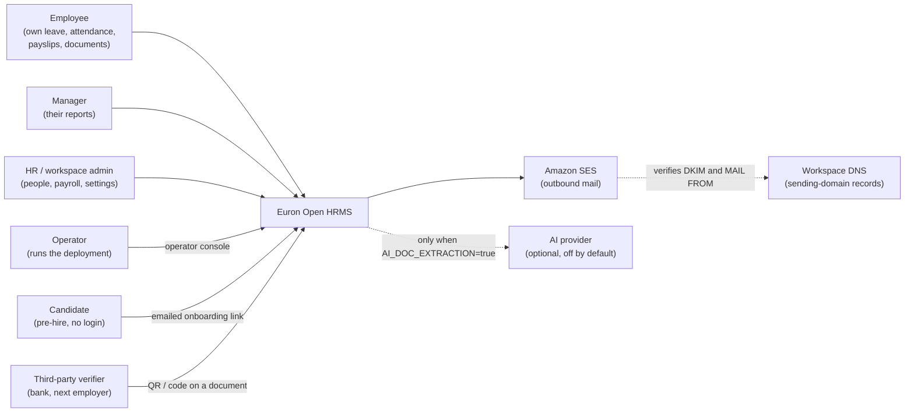
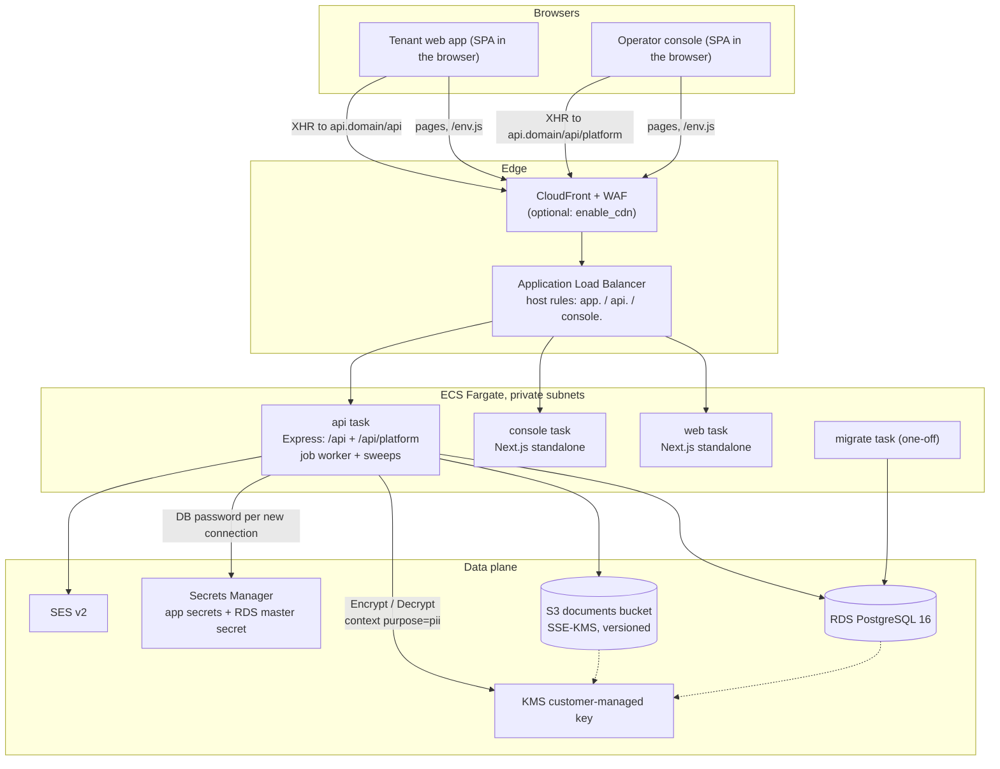
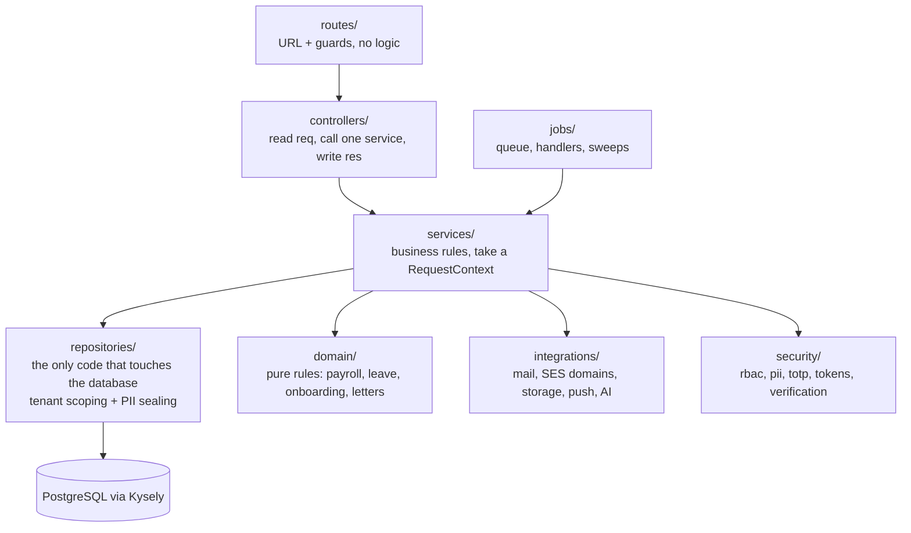
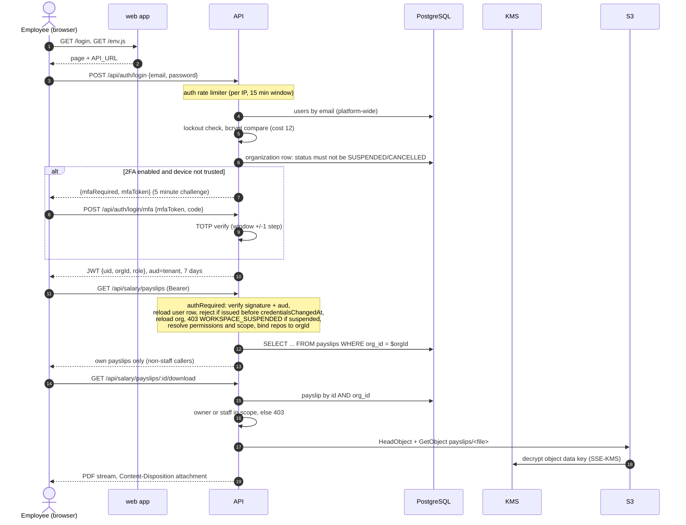
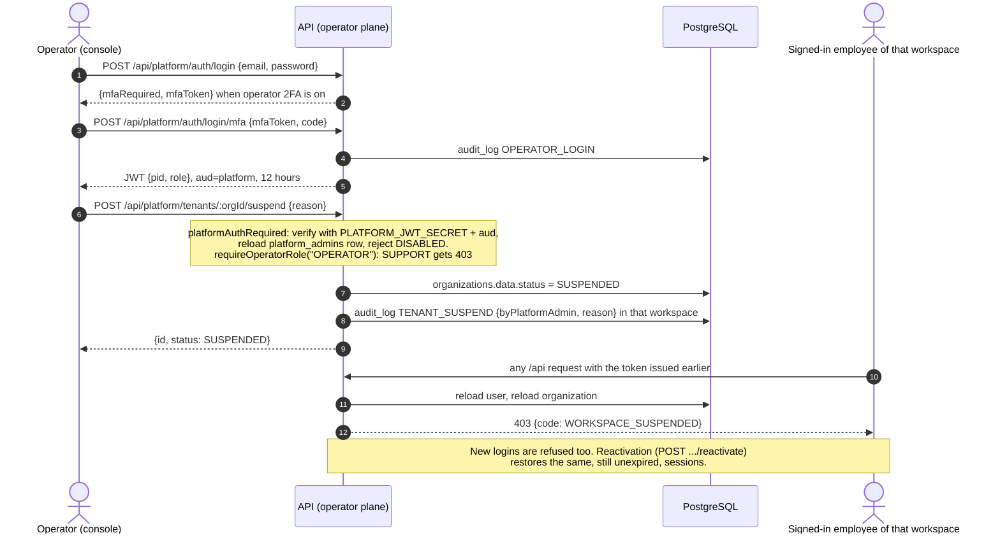
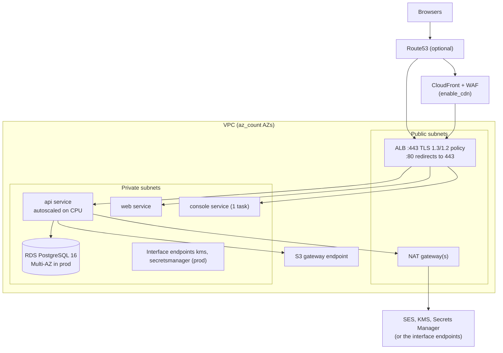

# High-level design

Euron Open HRMS is a multi-tenant HRMS: employees, attendance, leave, global payroll,
onboarding, documents, letters, separations, performance, and an operator console for the
people who run the service. It is an open-source project from ENGAGESPHERE TECHNOLOGY
PRIVATE LIMITED.

This document describes the system as it is built: what runs, where data lives, how a
request travels, and how the pieces are deployed. Deeper topics have their own pages:

| Topic | Page |
| --- | --- |
| Workspaces and tenant isolation | [multi-tenancy.md](multi-tenancy.md) |
| Authentication, RBAC, encryption, hardening | [security.md](security.md) |
| STRIDE analysis | [threat-model.md](threat-model.md) |
| Tables and storage model | [data-model.md](data-model.md) |
| Payroll rules and country packs | [payroll-engine.md](payroll-engine.md) |
| Decisions and their trade-offs | [adr/](adr/) |

## 1. System context

Four kinds of people use the system. Three of them sign in to the tenant web app; the
fourth is the operator who runs the deployment.

Two unauthenticated entry points exist on purpose:

- **Self-onboarding**: a candidate opens `/api/onboarding/public/:token` from an emailed
  link. The case token is stored as a SHA-256 hash (`onboarding_cases.token_hash`), the
  path has its own rate limiter, and access logs mask the token (see [security.md](security.md#http-hardening)).
- **Document verification**: anyone holding a payslip or letter can check it at
  `/api/verify/:code`. The public answer discloses only what the issuer opted into.

## 2. Containers

The repository builds three images. The API image also carries the migration runner and
the operator CLI, which run as one-off tasks with a different command.

| Container | Source | Image | Listens | Role |
| --- | --- | --- | --- | --- |
| Web app | `apps/web` (Next.js) | `infra/docker/web.Dockerfile` | 8080 | Tenant UI for HR, managers and employees. Serves `/env.js` with runtime configuration. |
| Operator console | `apps/console` (Next.js) | `infra/docker/console.Dockerfile` | 8080 | Fleet UI for operators: workspaces, activity, operators, security. |
| API | `apps/api` (Express) | `infra/docker/api.Dockerfile` | 8080 | Tenant plane `/api`, operator plane `/api/platform`, the background job worker and the leader-elected sweeps, all in one process. |
| Migrate (one-off) | `db/migrate.ts` | API image, `node dist/migrate.js` | none | Applies pending SQL migrations. |
| Operator CLI (one-off) | `apps/api/src/cli.ts` | API image, `node dist/cli.js` | none | `operator:create`, `demo:seed`. |

Shared packages:

| Package | Holds |
| --- | --- |
| `packages/api-client` | Axios client, per-app token store, the `/env.js` serialiser, the impersonation hand-off |
| `packages/types` | Request and response types shared by the API and both front ends |
| `packages/ui` | The component library both front ends render with |

Without `enable_cdn` the browsers reach the load balancer directly. The front-end images are
environment-agnostic: the API URL and product name are read at request time and served as
`/env.js`, never inlined at build time, so one image runs in every environment.

The browser calls the API host directly (`API_URL`), so the API enforces a CORS allowlist
(`CORS_ORIGINS`) containing exactly the web app and console origins. Tokens are bearer
tokens in an `Authorization` header, stored per app in `localStorage`.

## 3. The two planes

One API process serves two independent identity planes. They share code and a database, and
nothing else that matters for authentication.

| | Tenant plane | Operator plane |
| --- | --- | --- |
| Mount | `/api/*` | `/api/platform/*` |
| Users | `users` rows, one workspace each | `platform_admins` rows, no workspace |
| Signing secret | `JWT_SECRET` | `PLATFORM_JWT_SECRET` |
| JWT audience | `tenant` | `platform` |
| Session lifetime | `SESSION_TTL`, default 7 days | 12 hours |
| Middleware | `authRequired` (`middleware/auth.ts`) | `platformAuthRequired` (`middleware/platform-auth.ts`) |
| Data access | Repositories scoped to the caller's workspace | System repositories, `orgId` passed explicitly |
| Roles | Built-in and custom roles, permission codes | `OPERATOR` (full) and `SUPPORT` (read-mostly) |

A tenant token fails `jwt.verify` on the operator plane (wrong secret and wrong audience),
and the reverse holds too. The integration suite asserts both directions
(`security.int.test.ts`, "Token planes are separate"). [ADR 0004](adr/0004-operator-plane-in-the-same-api.md)
records why both planes live in one service.

## 4. Inside the API

The API is layered. Each layer calls only the one below it; see
[ADR 0008](adr/0008-layered-repository-pattern.md) and `apps/api/README.md`.

| Folder | Responsibility |
| --- | --- |
| `core/` | Configuration and production boot guards (`config.ts`), `HttpError`, logging, validation, the `RequestContext` |
| `security/` | `rbac.ts` (permission catalogue, roles, scope), `pii.ts` (envelope encryption), `totp.ts` (RFC 6238), `tokens.ts` (hashed single-use tokens), `verification.ts` (document QR codes) |
| `middleware/` | `auth.ts` (tenant sessions, password policy, `requirePermission`), `platform-auth.ts`, `guards.ts` |
| `repositories/` | `base.repository.ts` (the scoped store and table registry), `repository.ts` (base class), one repository per collection |
| `domain/` | Pure functions: `payroll/` (engine, country packs, structures, gratuity, exit pay), `leave-rules.ts`, `onboarding-*.ts`, letters, holidays |
| `integrations/` | `mail/mailer.ts`, `mail/ses-domains.ts`, `storage.ts`, `push.ts`, `ai/document-extract.ts` |
| `jobs/` | `queue.ts` (Postgres queue), `handlers.ts`, `access-sweep.ts`, `reminders/` |
| `pdf/` | Payslip, letter and signature rendering |
| `db/` | Kysely connection, generated types, rotation-safe connection settings |

### Boot sequence (`apps/api/src/index.ts`)

1. Pin `TZ=UTC` before any other import.
2. Run the production guards `assertSecrets`, `assertEmailFlow`, `assertStorage`. In
   production any problem exits the process; elsewhere they warn.
3. Connect to Postgres, retrying up to 6 times 3 seconds apart.
4. If `MIGRATE_ON_BOOT=true`, apply pending migrations under an advisory lock.
5. Create the S3 bucket if missing (S3 mode), then report whether storage is reachable.
6. Register every job handler, then start the queue worker.
7. Start the leader-elected sweeps, then listen on `PORT`.

`SIGTERM` and `SIGINT` stop the worker (draining in-flight jobs for up to
`QUEUE_DRAIN_MS`), close the HTTP server and end the pool. Recoverable network errors on
the database socket (`ECONNRESET`, `ETIMEDOUT` and similar) are logged without exiting; any
other uncaught exception exits so the orchestrator restarts the task.

### Health endpoints

| Path | Purpose | Behaviour |
| --- | --- | --- |
| `/up` | Liveness, load balancer health check | Registered before all middleware; never rate limited or authenticated |
| `/api/ready` | Readiness | `select 1` against Postgres; 503 when unreachable |

## 5. Request flow

Every tenant request passes the same chain: rate limiter (credential endpoints only),
`authRequired`, the route's guard, the controller, the service, and a repository already
bound to the caller's workspace.

### Employee signs in and opens a payslip

The bucket is never public and the API does not hand out presigned URLs for these
downloads: it checks the caller, reads the object and streams the bytes itself.

### Operator suspends a workspace

Because the workspace row is read on every authenticated request, suspension takes effect
on the next request rather than when tokens expire. The integration suite asserts that the
same token is refused immediately after suspension and works again after reactivation.

## 6. Data stores

| Store | What it holds | Notes |
| --- | --- | --- |
| PostgreSQL 16 | Every record: 42 tables from `db/migrations`, plus `schema_migrations` created by the runner | Hot columns plus a `data` JSONB document per row ([data-model.md](data-model.md)). Also hosts the job queue. |
| S3 documents bucket | Uploaded documents, generated payslips and letters, logos, signatures, under the prefixes `uploads/`, `payslips/`, `letters/` | Private, versioned, SSE-KMS, TLS-only policy. `STORAGE=local` writes to `DATA_DIR` instead (development only). |
| KMS key | Wraps each workspace's personal-data key; encrypts the bucket, RDS storage, Performance Insights, Secrets Manager secrets, ECR and CloudWatch log groups | One customer-managed key per deployment, annual rotation |
| Secrets Manager | `<name_prefix>/app`: `JWT_SECRET`, `PLATFORM_JWT_SECRET`, `DOC_VERIFY_SECRET`. The RDS-managed master user secret. | Injected into the task at start (app secrets) or read per new DB connection (DB password) |
| SES v2 | Platform sending identity (Terraform) and per-workspace sending identities (created by the API at runtime) | See [sending-domains.md](../guides/sending-domains.md) |

## 7. Background work

There is no Redis and no separate worker service. Every API task runs the job worker and
competes for jobs through Postgres.

### The job queue (`jobs/queue.ts`)

| Property | Behaviour |
| --- | --- |
| Storage | `jobs` table (`status`, `run_at`, `attempts`, `max_attempts`, `payload` JSONB, `org_id`) |
| Claim | In a transaction: the oldest due `QUEUED` job whose `type` this worker has a handler for, `FOR UPDATE SKIP LOCKED`, set to `RUNNING` |
| Poll | Every `QUEUE_POLL_MS` (default 1500 ms), draining at most 25 jobs per tick |
| Retry | On failure, requeue with backoff `min(60 s, 2^attempts s)` until `max_attempts` (default 3), then `FAILED` with `last_error` |
| Crash recovery | Once a minute, jobs stuck in `RUNNING` longer than `QUEUE_STUCK_MS` (default 5 min) are requeued, or failed if their retry budget is spent |
| Unroutable jobs | `QUEUED` jobs older than `QUEUE_UNROUTABLE_MS` (default 10 min) with no local handler are logged as a warning, never failed |
| Shutdown | Stops polling and waits up to `QUEUE_DRAIN_MS` (default 10 s) for in-flight jobs |

Filtering the claim by registered handler types is what keeps a rolling deploy safe: an old
task never claims (and burns the retries of) a job type only the new version understands.

Registered job types:

| Type | Enqueued by | Does |
| --- | --- | --- |
| `announcement.broadcast` | Posting an announcement | Fans out notifications |
| `onboarding.campaign.launch` | Launching an onboarding campaign | Expands the audience into cases |
| `onboarding.case.create` | Campaign fan-out | Opens one case and sends its request email |
| `onboarding.reminder` | The onboarding sweep | Sends a deadline reminder |
| `onboarding.escalate` | The onboarding sweep | Escalates an overdue case |

### Leader-elected sweeps

Periodic work that must run once per deployment, not once per task, is gated by a Postgres
advisory lock taken with `pg_try_advisory_lock` on one pinned connection and released on the
same connection. A task that does not get the lock skips that tick.

| Sweep | Interval | Lock key | Does |
| --- | --- | --- | --- |
| Access revocation (`jobs/access-sweep.ts`) | On boot, then every 6 h | 778001 | Disables logins of employees whose separation is completed or absconded, or whose last working day has passed; stamps `credentialsChangedAt` so their sessions die. Refuses to disable a workspace's only administrator. |
| Clock-in reminders (`jobs/reminders/clockin.ts`) | Every 5 min | 778002 | Sends each workspace's daily reminder at its own local time, deduplicated per employee per local date |
| Onboarding deadlines (`jobs/reminders/onboarding.ts`) | Every 15 min | 778003 | Decides which cases need a reminder or escalation and enqueues the jobs above |
| Migrations (`db/migrate.ts`) | On boot when `MIGRATE_ON_BOOT=true`, or as a one-off task | 727101 (blocking `pg_advisory_lock`) | Applies pending migrations; concurrent runners wait, then find nothing to do |

[ADR 0003](adr/0003-postgres-as-the-job-queue.md) records the choice of Postgres over a
dedicated broker.

## 8. Deployment topology (AWS)

`infra/terraform/modules/deployment` composes one complete environment from the modules
`network`, `kms`, `secrets`, `database`, `storage`, `email`, `ecr`, `edge`, `cdn`, `service`
and `observability`. `envs/aws-dev` and `envs/aws-prod` call it with different sizes and
safety switches; `envs/local-floci` runs the same `kms`, `storage`, `secrets` and `email`
modules against the local emulator.

| Concern | Implementation |
| --- | --- |
| Hostnames | `app.<domain>` (web), `api.<domain>` (API), `console.<domain>` (console), one ALB with host-header rules; unknown hosts get a fixed 404 |
| TLS | ACM certificate, DNS-validated through Route53, or an existing `certificate_arn` |
| Tasks | Fargate, ARM64, no public IP, read-only root filesystem with a writable `/tmp`, own security group and IAM roles per service, ECS Exec disabled |
| Rollout | Deployment circuit breaker with automatic rollback, minimum healthy 100 percent, maximum 200 percent |
| Scaling | CPU target tracking, target 60 percent, per-service minimum and maximum counts |
| Proxies | `TRUST_PROXY` is 1 behind the ALB, 2 with CloudFront in front |
| CDN | When `enable_cdn`: CloudFront for all three hostnames, `/_next/static/*` cached, everything else uncached with all viewer headers forwarded; the ALB then accepts HTTPS only from the CloudFront origin-facing prefix list |
| Observability | Alarms to an SNS topic (optionally emailed) and one CloudWatch dashboard |

The sizing differences between `aws-dev` and `aws-prod` are listed in
[deploy-aws.md](../guides/deploy-aws.md#sizing). [ADR 0006](adr/0006-fargate-behind-one-load-balancer.md)
explains the single load balancer.

## 9. Local topology

`make up` starts the same three images plus Postgres, Mailpit and the Floci AWS emulator,
and a one-shot Terraform container that provisions the emulator with the production
modules before the API starts. See [quickstart-local.md](../guides/quickstart-local.md) and
[ADR 0007](adr/0007-floci-for-local-aws.md).

| Service | Host port | Purpose |
| --- | --- | --- |
| web | 3410 | Tenant app |
| console | 3420 | Operator console |
| api | 5005 | API (container port 8080) |
| postgres | 5442 | PostgreSQL 16 |
| mailpit | 8025 (UI), 1025 (SMTP) | Captures every message |
| floci | 4576 | S3, KMS, Secrets Manager, Route53, SES |
