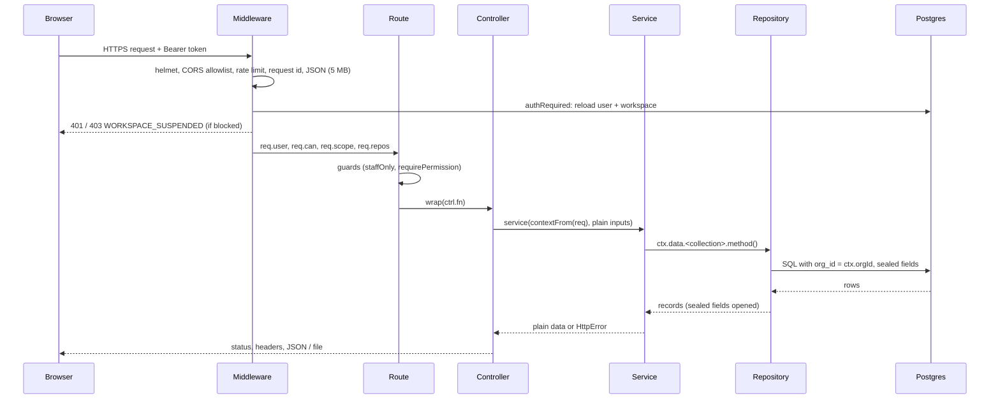
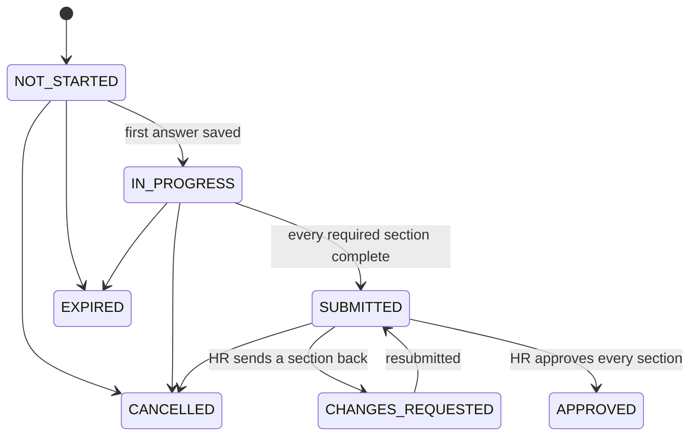

# Low-level design

How the API is built, module by module. The [HLD](HLD.md) covers the system around it;
[multi-tenancy](multi-tenancy.md) and [security](security.md) go deeper on those two topics.
All paths are relative to `apps/api/src/` unless stated otherwise.

## 1. Process layout

`index.ts` boots one Node process that does three jobs:

1. **HTTP server**: `createApp()` from `app.ts` builds the Express app with no side effects,
   so the integration tests run exactly the same app in-process.
2. **Job worker**: `jobs/queue.ts` polls the `jobs` table and runs registered handlers.
3. **Leader-elected sweeps**: timers that each take a Postgres advisory lock before running,
   so only one replica works at a time.

Boot order (`index.ts`):

1. Pin `TZ=UTC`, then load configuration.
2. Run the configuration guards in `core/config.ts` (`assertSecrets`, `assertEmailFlow`,
   `assertStorage`). They throw in production, warn elsewhere.
3. Connect to Postgres, with six attempts three seconds apart.
4. When `MIGRATE_ON_BOOT=true`, run the migration runner (`db/migrate.ts`) under its advisory lock.
5. Ensure the bucket exists and report whether storage is reachable.
6. Register the job handlers, start the worker, then start the sweeps:

   | Sweep | Every | Advisory lock |
   | --- | --- | --- |
   | Access revocation for exited employees (`jobs/access-sweep.ts`) | 6 h | `778001` |
   | Clock-in reminders, in each workspace's timezone (`jobs/reminders/clockin.ts`) | 5 min | `778002` |
   | Onboarding deadlines and escalation (`jobs/reminders/onboarding.ts`) | 15 min | `778003` |

7. Listen. `SIGTERM` drains in-flight jobs (up to `QUEUE_DRAIN_MS`), closes the server and the pool.

## 2. Request pipeline

**`middleware/auth.ts` `authRequired`**, in order:

1. Verify the JWT with `JWT_SECRET` and `audience: "tenant"`. A two-factor challenge token is
   refused, because it proves the password only.
2. Reload the user by id. The request is rejected if the user is gone, if `credentialsChangedAt`
   is newer than the token (a password change or "sign out everywhere"), or if the user is disabled.
3. Reload the workspace. A suspended or cancelled workspace gets `403 { code: "WORKSPACE_SUSPENDED" }`.
4. Resolve permissions: the union of every role the user holds, with custom roles read from
   the workspace. Then resolve the department/office scope.
5. Attach `req.repos = repos({ orgId: user.orgId })`. Every repository the request touches
   is bound to that workspace from here on.

**Errors.** Services throw `HttpError` (`core/util.ts`: `bad`, `forbidden`, `notFound`, ...).
The error handler in `app.ts` maps client errors from body-parser and multer to their own 4xx
status. Anything else becomes `500 { error: "Server error", requestId }`, and the original
error goes only to the log (and Sentry, when `SENTRY_DSN` is set).

## 3. Layers

| Layer | Contract |
| --- | --- |
| `routes/<x>.routes.ts` | `router.<verb>(path, ...guards, wrap(ctrl.fn))`. No logic. The OpenAPI reference is generated from these files (`scripts/gen-openapi.ts`). |
| `controllers/<x>.controller.ts` | Reads `req.params`, `req.query`, `req.body || {}` and uploaded files. Calls one service function with `contextFrom(req)`. Picks the status code and writes headers (downloads, CSV, PDF). |
| `services/<x>.service.ts` | Named functions `(ctx, ...inputs)`. Validation, rules, transactions, audit rows, notifications, mail. Never imports Express. |
| `repositories/<entity>.repository.ts` | Extends `Repository`. Adds domain queries (`findByName`, `forEmployee`, `activeReportsOf`, ...). The only code that reaches the database. |

**`core/context.ts` `RequestContext`:**

| Field | Contents |
| --- | --- |
| `orgId` | The caller's workspace |
| `user` | The user row, with its permissions resolved |
| `can(code)` | Permission check |
| `inScope(employee)` | Department/office scope check for one record |
| `scope` | The department/office scope itself |
| `impersonatorId` | Set during operator support sessions |
| `data` | One repository per collection (`repositories/index.ts`), each bound to the workspace |
| `repos` | The raw scoped store, for the few shared domain helpers that take it |

Jobs, sweeps, public token routes and the CLI build the same shape with `systemContext(orgId)`.

**`domain/`** holds pure rules with no I/O, so they are unit-tested in isolation:

- the payroll engine and country packs
- leave rules and policy
- onboarding templates and case state
- letter tokens and templates
- holiday calendars, settlement maths, employment-type defaults

## 4. The repository layer

`repositories/base.repository.ts` holds the storage model and its two guarantees.

**Storage model.** Every table has an `id`, a few *hot columns* (`org_id`, foreign keys,
statuses, dates, which can be indexed and filtered in SQL), a `data jsonb` document for
everything else, and timestamps. `readRow` flattens `{ ...data, ...hot, id, createdAt,
updatedAt }`; `splitRow` splits a record back into hot columns and data on write.
[ADR 0001](adr/0001-hot-columns-and-jsonb.md) explains the trade-off.

**`TABLES` registry.** One entry per collection: `{ table, cols, tenant }`. `tenant: true`
means every query gets `where org_id = ctx.orgId`, and every insert has its `orgId` forced to
the caller's workspace. The unit suite asserts that every table carrying `orgId` is registered
as tenant-scoped (the auth-token table is the one deliberate exception).

**Scoped store.** `repos(ctx)` builds one store per collection. Its methods are:

| Method | Notes |
| --- | --- |
| `all`, `find(pred)`, `findOne(pred)`, `byId`, `count` | Reads |
| `page(opts)` | SQL pagination on hot columns |
| `where(filter).list/one/count` | Equality filters pushed into SQL; hot columns only, anything else throws |
| `insert`, `update`, `remove`, `removeWhere` | Writes |
| `transaction(fn)` | One connection for every repository inside `fn` |

`systemRepos()` is the unscoped variant, used only by the operator plane, the cross-workspace
token lookups and the demo seed.

**Sealing.** Reads pass through `decode`, which opens sealed fields; writes call `sealFields`
before `JSON.stringify`. The fields come from `ENCRYPTED_FIELDS` in `security/pii.ts`.
Section 7 covers the cryptography.

**Retries.** Reads outside a transaction retry twice on transient network errors
(`ECONNRESET`, `ETIMEDOUT`, ...). Writes never retry.

## 5. Job queue

`jobs/queue.ts` keeps jobs in a Postgres table, so it needs no broker and a job can be
enqueued in the same transaction as the change that caused it.

- **Enqueue:** `enqueue(type, payload, { orgId, runAt, maxAttempts = 3 })`.
- **Claim:** in one transaction, select the oldest due `QUEUED` job `FOR UPDATE SKIP LOCKED`,
  then mark it `RUNNING`. The select is filtered to the job types this worker has handlers for,
  so a rolling deploy never hands a new job type to an old worker.
- **Retry:** exponential backoff `min(60 s, 1 s × 2^attempts)`, then `FAILED` with `last_error`.
- **Reaper:** a job `RUNNING` for longer than `QUEUE_STUCK_MS` (5 min) had its worker die;
  it is put back in the queue.
- **Unroutable:** a job no worker can run for `QUEUE_UNROUTABLE_MS` (10 min) is logged.

Handlers (`jobs/handlers.ts`): announcement broadcast, onboarding campaign launch (fan-out),
onboarding case creation, reminder and escalation mail.

## 6. Mail

`integrations/mail/mailer.ts` has three transports, chosen by `MAIL_MODE`:

| Mode | Behaviour |
| --- | --- |
| `outbox` | Writes `.eml` files under `DATA_DIR/outbox`. Refused in production. |
| `smtp` | nodemailer SMTP transport |
| `ses` | Builds the MIME message, then sends it raw through SES v2 |

**`senderFor(org)`** resolves who a workspace's mail comes from, and says why when it is
not the workspace's own domain:

1. A verified workspace domain with a From address: `Name <hr@mail.acme.example>`.
2. Otherwise, the workspace's sender name over the platform address.
3. Otherwise, the platform default (`MAIL_FROM`).

`sendTenantMail` always goes through this resolution and never throws (`sendMailSafe`).

**`integrations/mail/ses-domains.ts`** manages the sending-domain lifecycle:

- create the identity with Easy DKIM (RSA 2048) and the platform configuration set
  (`SES_CONFIGURATION_SET`)
- set the custom MAIL FROM (`bounce.<domain>`)
- build the DNS records
- check DKIM and MAIL FROM status, and delete

**`services/sending-domain.service.ts`** owns the rules on top:

- one domain per workspace
- the platform domain is reserved
- region drift is detected and fixed by re-provisioning
- the sender is adopted on verification
- a test send always goes to the caller

## 7. Personal-data encryption

`security/pii.ts`:

**Key hierarchy:**

| Key | Where it lives |
| --- | --- |
| KMS key | Created by Terraform; locally, a 32-byte `PII_MASTER_KEY` |
| One 256-bit data key per workspace | Wrapped in `org_data_keys` (scheme `kms` or `local`, `key_ref`, `wrapped_key`) |

**Wrapping.** With KMS, `Encrypt`/`Decrypt` with `EncryptionContext { orgId, purpose: "pii" }`.
The API task role is only allowed KMS operations carrying `purpose=pii`. Locally, AES-256-GCM
under the master key, with the org id as additional data.

**Caching.** Unwrapped keys are kept in process memory for 10 minutes, so KMS sees one
`Decrypt` per workspace per window. Concurrent first uses share one in-flight request. Two
replicas racing to create a key resolve through `ON CONFLICT DO NOTHING`.

**Fields.** AES-256-GCM with a random 96-bit IV. The stored value is
`{ "$enc": "v1", iv, ct, tag }`, with additional data
`open-hrms|<table>|<orgId>|<rowId>|<field>`. A ciphertext moved to another row, field or
workspace fails authentication.

**Legacy plaintext** (rows written before encryption) is read as-is and sealed on the next save.

**Crypto-shredding.** Workspace purge deletes the `org_data_keys` row last.

## 8. Onboarding

**Cases** (`domain/onboarding-case.ts`) move through these statuses:

Each section has its own state: `EMPTY`, `PARTIAL`, `COMPLETE`, `APPROVED` or
`CHANGES_REQUESTED`.

- **Answers.** The candidate's answers stay on the case (sealed, as `sections`) until HR
  approves. Only then are they mapped onto the employee record, merging nested objects such as
  `kyc` field by field so unrelated values survive.
- **Forms.** `domain/onboarding-template.ts` validates a form (field types, named patterns
  such as PAN or Aadhaar, employment-type filters). `domain/onboarding-presets.ts` ships
  ready-made forms.
- **Campaigns** fan out one case per targeted employee through the queue. The deadline sweep
  decides who gets a reminder (per-workspace timezone, de-duplicated per offset) and when to
  escalate to the manager and HR.
- **Public routes** (`routes/onboarding.public.routes.ts`) authenticate by a token in the URL.
  Case tokens are stored only as a hash; legacy invite tokens are looked up directly. The token
  is masked in access logs.

## 9. Payroll

`domain/payroll/` is pure:

| Module | Role |
| --- | --- |
| `engine.ts` | `computePayroll(ruleset, earnings, extras)`: gross, statutory deductions, employer contributions, net |
| `countries/` | One ruleset per country (24 built in), plus a generic fallback |
| `structure.ts` | CTC to components, including CTC-inclusive conventions |
| `professional-tax.ts` | Per-state slabs |
| `gratuity.ts` | Gratuity |
| `exit-pay.ts` | Proration for the final month |
| `salary-sheet.ts` | Spreadsheet import |
| `payslip-input.ts` | Builds earnings and extras from a stored salary or a sheet row |

`services/payroll.service.ts` ties these together:

1. Assemble the inputs.
2. Issue the verification record *before* rendering, so the QR code exists.
3. Render the PDF (`pdf/payslip.ts`).
4. File it as a document.
5. Record the pay run.
6. Optionally email it.

Sheet imports (`services/payslip-import.service.ts`) use the same parser for preview and
commit, so what HR previewed is what gets paid. The [payroll engine](payroll-engine.md)
document has the details.

## 10. Documents and verification

`security/verification.ts` issues a short code (Crockford base32, no ambiguous letters) per
document and signs a digest of the document's facts with `DOC_VERIFY_SECRET`. The QR code
points at `/verify/<code>` in the web app. The public route returns the facts and a
genuine/revoked verdict, behind a dedicated rate limiter. Deleting a payslip revokes its code
rather than deleting it, so an old printed copy reads "revoked", not "unknown".

## 11. Frontends

- **Runtime config.** `apps/web` and `apps/console` serve `/env.js` from a route handler that
  writes `globalThis.__HRMS_ENV` from the server's environment (`API_URL`, `PRODUCT_NAME`,
  `TENANT_URL`), escaped for script context. The root layout loads it before hydration, so one
  image serves every environment.
- **API client.** `packages/api-client` creates the axios client and token store, and turns a
  401 into sign-out. A 403 `WORKSPACE_SUSPENDED` keeps the token and switches the app to the
  suspended screen instead.
- **Impersonation.** The hand-off travels in the URL fragment (`#imp=<token>`), never in a
  query string, and the web app consumes and clears it.
- **Shared code.** `packages/ui` holds the components and design tokens; `packages/types`
  holds the API shapes both apps share.

## 12. Migrations

`db/migrate.ts` applies `db/migrations/NNNN_*.sql` in order, each in its own transaction,
recorded in `schema_migrations` with a SHA-256 checksum. It runs under advisory lock
`727101`, so concurrent boots are safe. An edited, already-applied migration stops the runner.

## 13. Type coverage

Every package is TypeScript strict. In the API, `noImplicitAny` is off: route handlers and the
generic repository still take untyped `req` and `res`, and records are jsonb documents. Every
other strict check (null checks, strict function types, `useUnknownInCatchVariables`) is on.
Typing the handlers and adding per-endpoint request and response schemas is on the
[roadmap](../../README.md#️-roadmap).
