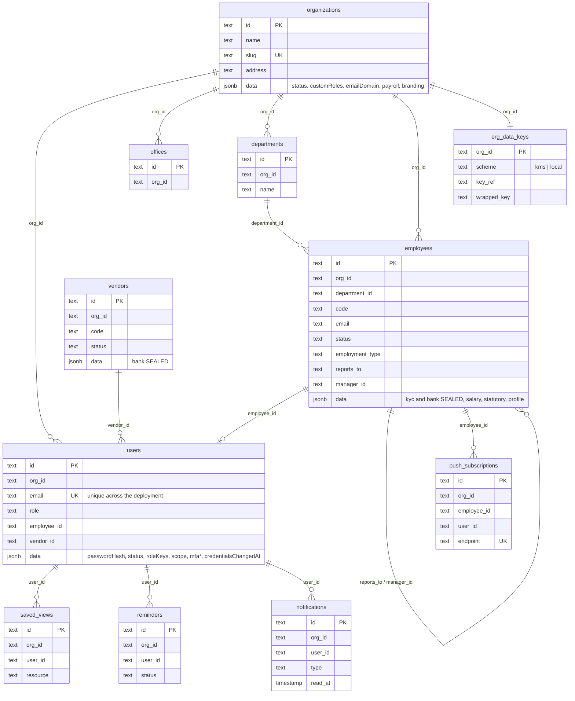
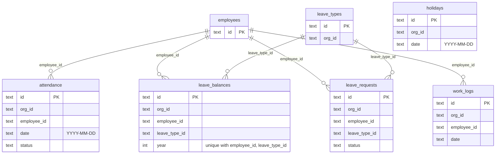
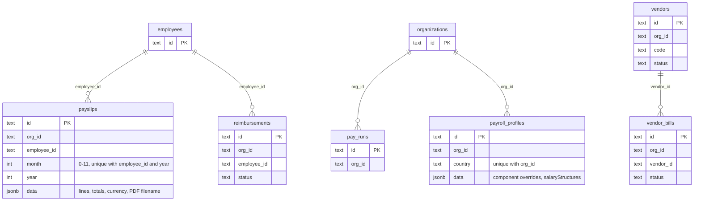
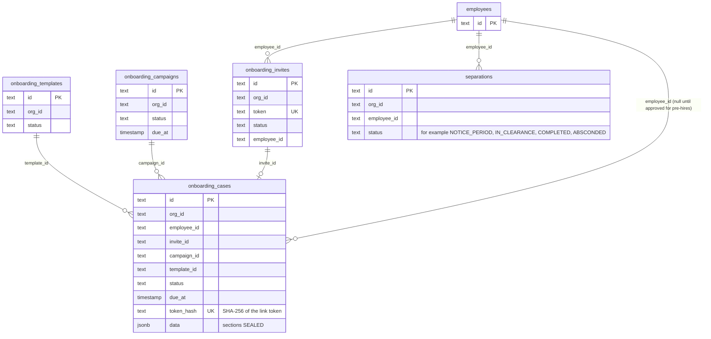
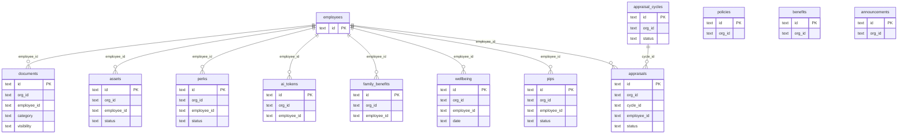
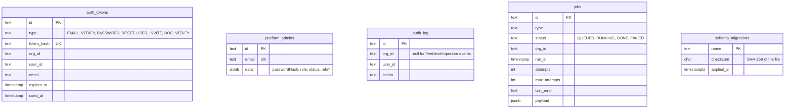

# Data model

The schema is owned by plain SQL migrations in `db/migrations` (eight files, applied in
order by `db/migrate.ts`). All runtime queries go through Kysely; `apps/api/src/db/types.ts`
is generated from a migrated database. This page explains the storage model, then shows
every table grouped by domain.

## Storage model: hot columns plus a `data` document

Every application table has the same shape:

```sql
CREATE TABLE "<table>" (
  "id"         TEXT NOT NULL PRIMARY KEY,         -- random UUID, assigned by the repository
  "org_id"     TEXT NOT NULL,                     -- the workspace (tenant tables)
  -- hot columns: foreign ids, status, dates, anything filtered or joined in SQL
  "data"       JSONB NOT NULL DEFAULT '{}',       -- everything else
  "created_at" TIMESTAMP(3) NOT NULL DEFAULT CURRENT_TIMESTAMP,
  "updated_at" TIMESTAMP(3) NOT NULL DEFAULT CURRENT_TIMESTAMP
);
```

The repository layer (`repositories/base.repository.ts`) hides the split:

- **On read**, a row becomes one flat object: `{ ...data, ...hotColumns, id, createdAt,
  updatedAt }`, with snake_case columns mapped to camelCase and timestamps as ISO strings.
- **On write**, the object is split back: keys listed as hot columns for that table go to
  their columns, every other key goes into `data`.
- **Filtering in SQL** (`where`, `page`, `removeWhere`) is allowed only on hot columns; any
  other key throws. Hot columns carry the indexes.

Why this model: HR records vary a great deal by country, by workspace configuration
(custom onboarding fields, payroll components, letter templates) and over time. Keeping the
long tail in JSONB lets a feature add a field without a migration, while everything the
database must filter, join, index or keep unique is a real column. The trade-offs
(no database-level type checks inside `data`, no foreign keys, filtering on non-hot fields
happens in the application) are recorded in
[ADR 0001](adr/0001-hot-columns-and-jsonb.md).

Conventions:

| Convention | Detail |
| --- | --- |
| Identifiers | `TEXT` primary keys; the repository assigns `crypto.randomUUID()` unless a caller supplies one |
| Relationships | By id only. The migrations declare no foreign-key constraints; integrity is maintained by the services, and cascading deletes are explicit (`removeWhere`) |
| Timestamps | `TIMESTAMP(3)` without time zone; the process runs with `TZ=UTC`, so stored values are UTC |
| Calendar dates | `TEXT` in `YYYY-MM-DD` form where a date is a day, not an instant (`attendance.date`, `holidays.date`, `work_logs.date`, `wellbeing.date`) |
| Tenant scoping | Every tenant table has `org_id`, indexed. See [multi-tenancy.md](multi-tenancy.md) |
| Unscoped tables | `organizations`, `auth_tokens`, `platform_admins`, `jobs`, `org_data_keys`, `schema_migrations` |

## Tables by domain

Columns shown are the hot columns (and `data` where it matters). Lines are id references,
not database constraints. Tables: 42 from the migrations, plus `schema_migrations`.

### Workspaces, people and access



`employees.reports_to` and `employees.manager_id` hold the same value; the repository keeps
them identical on every write (`domain/manager.ts`).

### Time, leave and holidays



### Payroll, reimbursements and vendors



### Onboarding and separations



### Documents, workplace, content and performance



### Platform and system tables



| Table | Notes |
| --- | --- |
| `auth_tokens` | Account-lifecycle tokens (only the SHA-256 hash is stored) and document-verification records (`type = DOC_VERIFY`; their `token_hash` column holds `DOC_VERIFY:<code>`, the public code itself, which is not a secret). Not tenant-scoped in the registry because it is queried before anyone is signed in; rows still carry `org_id` and are deleted with their workspace |
| `platform_admins` | Operator accounts; no workspace |
| `audit_log` | Indexed by `(org_id, created_at)` and `(org_id, action)` |
| `jobs` | The background queue, indexed by `(status, run_at)`. See [HLD.md](HLD.md#7-background-work) |
| `org_data_keys` | One wrapped 256-bit data key per workspace; `scheme` is constrained to `kms` or `local`. Deleting a row crypto-shreds that workspace's sealed fields |
| `schema_migrations` | Created by the migration runner, not by a migration file |

## Sealed fields

These top-level `data` keys are encrypted per workspace before they reach Postgres
(`security/pii.ts`, `ENCRYPTED_FIELDS`):

| Table | Field |
| --- | --- |
| `employees` | `kyc`, `bank` |
| `onboarding_cases` | `sections` |
| `vendors` | `bank` |

In the database each appears as `{"$enc": "v1", "iv": ..., "ct": ..., "tag": ...}`. Hot
columns are never sealed. Mechanism and key hierarchy:
[security.md](security.md#personal-data-encryption).

## Unique constraints

| Index | Enforces |
| --- | --- |
| `organizations_slug_key` | One slug per workspace |
| `users_email_key` | One login per email address across the deployment |
| `leave_balances_employee_id_leave_type_id_year_key` | One balance per employee, leave type and year |
| `payslips_employee_id_month_year_key` | One payslip per employee per month |
| `payroll_profiles_org_id_country_key` | One payroll profile per workspace and country |
| `onboarding_invites_token_key`, `onboarding_cases_token_hash_key` | Link tokens resolve to one record |
| `auth_tokens_token_hash_key` | A token or verification code resolves to one record |
| `platform_admins_email_key` | One operator per email |
| `push_subscriptions_endpoint_key` | One subscription per browser endpoint |

## Migrations

| File | Adds |
| --- | --- |
| `0001_init.sql` | The 33 core tables and their indexes |
| `0002_saas.sql` | `auth_tokens`, `platform_admins` |
| `0003_notifications.sql` | `notifications` |
| `0004_jobs.sql` | `jobs` |
| `0005_payroll_profiles.sql` | `payroll_profiles`, plus two `audit_log` indexes |
| `0006_push_subscriptions.sql` | `push_subscriptions` |
| `0007_onboarding_flow.sql` | `onboarding_templates`, `onboarding_cases`, `onboarding_campaigns` |
| `0008_org_data_keys.sql` | `org_data_keys` |

The runner applies pending files in filename order, each in its own transaction, under a
Postgres advisory lock, and records a SHA-256 checksum. A file that changes after it was
applied stops the runner with `<file> changed after it was applied; add a new migration
instead`. Operating procedures are in [operations.md](../guides/operations.md#migrations).
