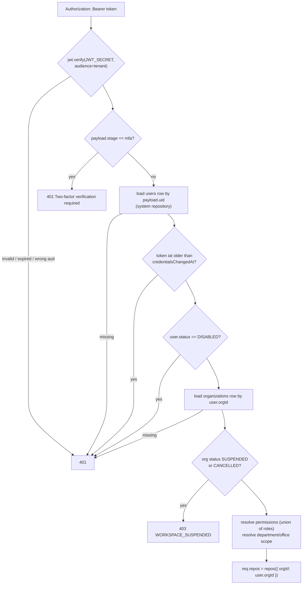

# Multi-tenancy

Euron Open HRMS serves many organisations from one deployment and one database. Each
organisation is a **workspace**. This page explains how a request is bound to exactly one
workspace, how the data layer keeps it there, how that is tested, and how per-workspace
resources (encryption keys, sending domains) and workspace deletion work.

## Workspace model

A workspace is one row in `organizations`. Everything a workspace owns carries its id in an
`org_id` column.

| Attribute | Where | Notes |
| --- | --- | --- |
| `id`, `name`, `slug` | hot columns | `slug` is unique across the deployment |
| `status` | `data.status` | `PENDING_VERIFICATION`, `ACTIVE`, `SUSPENDED`, `CANCELLED` |
| Custom roles | `data.customRoles` | See [custom-roles.md](../guides/custom-roles.md) |
| Sending domain | `data.emailDomain` | At most one; see [sending-domains.md](../guides/sending-domains.md) |
| Payroll settings | `data.payroll` | Country, currency, locale, CTC convention, professional-tax state |

A workspace comes into existence in one of three ways:

| Path | Initial status | Becomes `ACTIVE` when |
| --- | --- | --- |
| Self-signup (`POST /api/signup`) | `PENDING_VERIFICATION`, admin user `INVITED` | The admin redeems the emailed verification link (`EMAIL_VERIFY` token, 48 h) |
| Operator creates it (`POST /api/platform/tenants`) | `ACTIVE`; the first admin is `INVITED` (emailed invite) or `ACTIVE` with an operator-set password | The admin accepts the invite (`USER_INVITE` token, 7 days) |
| Demo seed (`make demo`) | `ACTIVE` | n/a; refused when `NODE_ENV=production` |

New workspaces receive the starter-content packs (leave types, policies, benefits,
departments, an onboarding template and, for Indian workspaces only, the holiday calendar)
and no demo people.

**One login, one workspace.** `users.email` has a unique index across the whole database and
sign-in is by email with no workspace picker, so a login identity belongs to exactly one
workspace.

## Resolving the workspace for a request

The workspace is never taken from the URL, a header or the request body. It comes from the
signed-in user's own database row, reloaded on every request by `authRequired`
(`apps/api/src/middleware/auth.ts`):

Consequences of this design:

- The `orgId` claim inside the token is informational. Scoping uses `user.orgId` from the
  row, so a token cannot be pointed at another workspace.
- Disabling a user, changing a password, "sign out everywhere", suspending a workspace and
  editing a role all take effect on the next request, not when tokens expire. The cost is
  two primary-key lookups per request (user, organisation).
- Background jobs, sweeps and the CLI build an equivalent context with
  `systemContext(orgId)` (`core/context.ts`): the same scoped repositories, full
  permissions.

## The scoped repository

All tenant data access goes through `repos(ctx)` in
`apps/api/src/repositories/base.repository.ts`. It returns one store per collection, bound to
`ctx.orgId`, and the repository classes (`repositories/repository.ts`) wrap those stores.
Services never build SQL; see [ADR 0002](adr/0002-jwt-tenant-resolution-and-scoped-repository.md)
and [ADR 0008](adr/0008-layered-repository-pattern.md).

### The table registry

`TABLES` in `base.repository.ts` maps each collection to its table, its hot columns and a
`tenant` flag:

| `tenant` | Collections |
| --- | --- |
| `true` | `users`, `offices`, `departments`, `employees`, `leaveTypes`, `leaveBalances`, `leaveRequests`, `documents`, `attendance`, `payslips`, `payRuns`, `payrollProfiles`, `reimbursements`, `vendors`, `vendorBills`, `onboardingInvites`, `onboardingTemplates`, `onboardingCases`, `onboardingCampaigns`, `separations`, `holidays`, `policies`, `benefits`, `announcements`, `pips`, `appraisalCycles`, `appraisals`, `workLogs`, `aiTokens`, `assets`, `perks`, `familyBenefits`, `wellbeing`, `savedViews`, `reminders`, `auditLog`, `notifications`, `pushSubscriptions` |
| `false` | `organizations` (the root), `authTokens` (looked up by token hash before anyone is signed in), `platformAdmins` (operators have no workspace) |

A unit test (`test/unit/security.test.ts`, "Tenant scoping registry") fails if a table with
an `orgId` column is added without `tenant: true`, other than the deliberate globals.

### What the store guarantees

For a tenant collection with a context that has an `orgId`:

| Operation | Enforcement |
| --- | --- |
| `all`, `find`, `findOne`, `count`, `page`, `where(...)` | `WHERE org_id = $orgId` is part of the base query |
| `byId(id)` | `WHERE id = $id AND org_id = $orgId`: another workspace's id returns `null` (the caller answers 404) |
| `insert(doc)` | `org_id` is overwritten with `ctx.orgId`, whatever the document says |
| `update(id, patch)`, `remove(id)`, `removeWhere(filter)` | `AND org_id = $orgId` on the statement |
| `where(filter)`, `removeWhere(filter)` | Only hot columns are accepted; anything else throws, so a filter cannot silently become a full scan |
| `transaction(fn)` | The repositories handed to `fn` are bound to the same workspace and the same transaction |

Personal-data sealing (below) happens in the same place, so a caller can forget neither.

### Cross-workspace work

`systemRepos()` builds the same stores with `{ system: true }`, which skips the `org_id`
filter and uses each document's own `orgId`. It is used where crossing workspaces is the
point:

| Caller | Why |
| --- | --- |
| `authRequired`, sign-in, password reset, invite acceptance | The user and the workspace are not known until the row is found |
| The operator plane | Operators act on any workspace; they name it explicitly (`:orgId`) |
| Sweeps (`jobs/`) | Iterate over every workspace, then switch to `repos({ orgId })` per workspace |
| Sending-domain uniqueness | Must see every workspace's domain to refuse a duplicate |
| Seeding and the CLI | Create workspaces and operators |

A context without an `orgId` is also unscoped. Request handlers never produce one:
`users.org_id` is `NOT NULL` and `authRequired` refuses a user whose workspace row is missing.

Tables outside the registry (`jobs`, `org_data_keys`, `schema_migrations`) are read and
written directly by the queue, the key manager and the migration runner.

## Why there is no row-level security yet

The repository layer is today the only enforcement point for tenant isolation in the
database. Postgres row-level security is not enabled, and adding it as a second layer is on
the roadmap. The reasons it is not there yet:

- The API connects with a single database role (on AWS, the RDS master user), so policies
  would have to key off a per-request setting such as `SET LOCAL app.org_id`, which means
  pinning a connection for every request and every repository call inside it.
- Legitimate cross-workspace paths (sign-in lookup, the operator plane, sweeps, the queue)
  would each need a bypass role or policy, and that bypass is exactly where mistakes hide.
- The repository already makes the unscoped query unrepresentable for service code, and
  the isolation sweep below tests the whole HTTP surface.

Until then, the guarantees on this page are application-level guarantees. The
[threat model](threat-model.md) lists the residual risk.

## The isolation sweep

`apps/api/test/integration/isolation.int.test.ts` tests isolation across the whole tenant
API instead of spot-checking a few endpoints.

1. **Inventory from source.** It reads `app.ts`, finds every router mounted behind
   `authRequired`, and collects every route with a path parameter. A new route is covered
   the day it is added. The test asserts the inventory is larger than 80 routes.
2. **Victim data.** Workspace A (`Acme`) gets real records in the tables a tenant normally
   fills (leave request, reimbursement, announcement, document). Up to two ids per tenant
   table are collected (more than 15 in total), plus sentinel strings: every employee email
   and employee code in A.
3. **Fingerprint.** Every row of A in every tenant table is hashed over
   `(updated_at, data)`.
4. **Attack.** Signed in as the admin of workspace B (`Globex`, holding every permission in
   B), the test calls every parameterised route with every victim id (more than 1000
   requests), with an empty body for writes.
5. **Assertions.**
   - No response is a 5xx.
   - No successful `GET` body contains any of A's sentinels.
   - After the sweep, no row of A has changed and no row was created in A.
6. **Detector check.** A's own admin reading one of A's employees does see a sentinel, so
   the sweep cannot pass by matching nothing.

What it proves: no parameterised route on the tenant plane lets a fully privileged user of
one workspace read or modify another workspace's records by id. What it does not cover:
list endpoints without a path parameter (covered structurally by the base query, not by
this sweep), ids passed in query strings or bodies, the public routes (`/api/auth`,
`/api/signup`, `/api/onboarding/public`, `/api/verify`) and the operator plane, which is
cross-workspace by design.

## Per-workspace encryption keys

Sensitive personal fields are encrypted with a 256-bit data key that belongs to one
workspace (table `org_data_keys`, one row per workspace). The key is created on first use,
wrapped by KMS with the encryption context `{orgId, purpose: "pii"}` (or by a local master
key in development), and the plaintext key exists only in API memory, cached for 10
minutes. Every ciphertext's additional authenticated data names the table, the workspace,
the row and the field, so a value copied into another workspace fails to decrypt. Details
are in [security.md](security.md#personal-data-encryption).

## Per-workspace sending domains

A workspace may send its mail from its own domain. The rules that keep this
multi-tenant-safe live in the sending-domain service:

- **One domain per workspace.** Adding a second domain is refused until the first is
  removed. Re-adding the same domain is idempotent.
- **One workspace per domain.** SES identities are account-wide, so without a check a
  second workspace could register a domain another workspace had verified, see it report
  `VERIFIED`, and send as that workspace. The API scans every workspace's `emailDomain` and
  answers `409 EMAIL_DOMAIN_TAKEN` if another workspace holds it.
- **The platform domain is reserved.** The domain of `MAIL_FROM` cannot be claimed
  (`409 EMAIL_DOMAIN_TAKEN`).
- **Sender resolution is per workspace.** Mail for a workspace goes out from its own domain
  only when that domain is `VERIFIED` and has a From address; otherwise from the platform
  address, optionally with the workspace's display name.

The full lifecycle is in [sending-domains.md](../guides/sending-domains.md).

## Deleting a workspace

Operators can permanently delete a workspace from the console
(`DELETE /api/platform/tenants/:orgId`, `OPERATOR` role only). Two guardrails make it a
deliberate two-step action: the workspace must already be `SUSPENDED`, and the request must
echo the workspace name exactly (`confirmName`).

The purge runs in this order:

1. A fleet-level audit row `TENANT_DELETE` is written with no `org_id`, so it survives the
   purge (name, slug, operator id, reason).
2. Every table in the registry that has an `org_id` column is cleared of that workspace's
   rows: all tenant tables, plus `auth_tokens` (sign-in tokens and document-verification
   records). Then its `jobs`.
3. **Crypto-shredding:** the workspace's `org_data_keys` row is deleted and the key is
   dropped from the in-process cache. Every field that was ever sealed under that key
   becomes permanently unreadable, including copies in database backups taken before the
   purge.
4. The `organizations` row is deleted.

What the purge does not remove, so an operator must handle it separately:

| Left behind | Why it matters | What to do |
| --- | --- | --- |
| Objects in the documents bucket (`uploads/`, `payslips/`, `letters/`) | Files are encrypted with the deployment's KMS key, not the workspace key, so shredding does not cover them | Delete them under your retention policy; bucket versioning keeps superseded versions for the configured window (90 days by default) |
| The workspace's SES identity, if it had a sending domain | It stays in the SES account | Remove the domain from the workspace before purging, or delete the identity in SES |
| Unsealed fields in database backups | Only the fields listed in `ENCRYPTED_FIELDS` are shredded; names, emails and salaries in older backups stay readable until those backups expire | Size `db_backup_retention_days` to your obligations |

Operators can also download a full JSON snapshot of a workspace before deleting it
(`GET /api/platform/tenants/:orgId/export`, audited as `DATA_EXPORT`). The export is
produced through the repositories, so sealed fields are decrypted in it; treat the file as
the most sensitive artefact the system produces.
