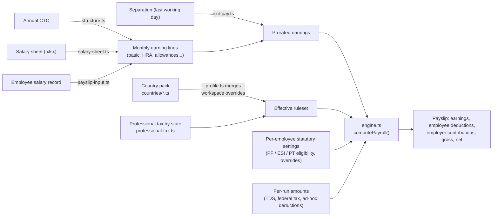

# Payroll engine

Payroll in Euron Open HRMS is a country-agnostic gross-to-net engine driven by per-country
rule packs. The engine never hard-codes a country, a currency or a statutory rate; adding a
country means adding a pack. Everything described here lives in
`apps/api/src/domain/payroll/` and is pure code: no database, no HTTP, unit-tested in
isolation.

Scope: the system computes and records amounts, renders payslips and keeps pay-run
history. It has no bank or payment integration.

## Building blocks



| File | Responsibility |
| --- | --- |
| `types.ts` | `PayComponent`, `CountryRuleset`, `PayrollInput`, `PayrollResult`, salary structure and statutory types |
| `engine.ts` | `computePayroll()`, the gross-to-net computation |
| `countries/index.ts` | Pack registry, country normalisation, generic fallback |
| `countries/in.ts`, `us.ts`, `uk.ts`, `more-countries.ts` | Built-in statutory packs |
| `iso-countries.ts` | Name, ISO 4217 currency and BCP-47 locale for every selectable country |
| `profile.ts` | A workspace's effective ruleset (pack plus overrides), seeding `payroll_profiles` on first use; salary structures |
| `structure.ts` | Annual CTC to monthly earning lines |
| `professional-tax.ts` | Indian professional tax by state |
| `gratuity.ts` | Statutory gratuity on separation (India) |
| `exit-pay.ts` | Proration for joining and leaving months |
| `salary-sheet.ts` | Parser for real-world salary-master workbooks |
| `payslip-input.ts` | Turns an employee record, a run payload or a sheet row into engine input; shared by preview and commit |

## Country packs

`countries/index.ts` registers the built-in packs. There are **24**:

| Source file | Countries |
| --- | --- |
| `in.ts` | India (IN) |
| `us.ts` | United States (US) |
| `uk.ts` | United Kingdom (UK) |
| `more-countries.ts` (21) | Canada (CA), Australia (AU), Brazil (BR), Mexico (MX), Germany (DE), France (FR), Netherlands (NL), Ireland (IE), Spain (ES), Italy (IT), Poland (PL), United Arab Emirates (AE), Saudi Arabia (SA), Singapore (SG), Japan (JP), China (CN), Philippines (PH), Indonesia (ID), South Africa (ZA), Nigeria (NG), Kenya (KE) |

Every pack states `effectiveFrom` (the tax year its defaults reflect, from `2024` to
`FY2025-26` across the set) and `source`. Statutory rates change every year; every value is an editable
default, not tax advice.

**Generic fallback.** `iso-countries.ts` lists 119 countries. The 95 without a built-in
pack are still selectable: `getRuleset()` returns a generic ruleset with the right currency
and locale, a 0 percent employee social-security deduction, a 0 percent employer
contribution and a per-payslip income tax line, marked `generic: true` so the settings UI
asks HR to configure the rates. Completely unknown input falls back to India.
`normalizeCountry()` accepts aliases such as `india`, `usa`, `gb`, `united kingdom` and
`uae`. The code uses `UK`, not `GB`, for the United Kingdom.

### What the packs contain

| Pack | Employee side | Employer side | Entered per run by HR |
| --- | --- | --- | --- |
| India | PF 12 percent of basic, base capped at 15,000; ESI 0.75 percent of gross, only when gross is at or below 21,000 (a ceiling, not a cap); professional tax (state-specific, see below) | PF 12 percent of basic, capped at 15,000; ESI 3.25 percent, same ceiling | Income tax (TDS) |
| United States | Social Security 6.2 percent; Medicare 1.45 percent | Social Security 6.2 percent; Medicare 1.45 percent | Federal tax, state tax, 401(k) elective deferral |
| United Kingdom | PAYE on monthly bands (0, 20, 40, 45 percent); employee NI on monthly bands (0, 8, 2 percent); pension 5 percent | Employer NI 13.8 percent above the monthly threshold; pension 3 percent | n/a (verify bands against the employee's tax code) |
| The 21 others | Social contributions as percentage components, with caps and notes where the scheme has them | Employer contributions | Income tax in every one of them |

Income tax is entered per run everywhere except the UK's PAYE bands, because it depends on
per-employee allowances, tax codes, regimes and annual projection that a stored rate cannot
represent. Some packs carry notes for nationals-only schemes (UAE, Saudi Arabia, Singapore)
and city- or prefecture-specific rates (China, Japan).

## The engine

`computePayroll(input: PayrollInput): PayrollResult`

### Inputs

| Field | Meaning |
| --- | --- |
| `earnings` | Earning lines `{ key, label, amount, taxable? }`. Lines with amount 0 or less are dropped. The line with key `basic` is the `BASIC` base |
| `ruleset` | The effective `CountryRuleset` (pack plus workspace overrides) |
| `extras` | Per-run amounts keyed by component key. For a ruleset component the value replaces the computed amount (this is how TDS or federal tax is entered). Keys starting with `adhoc_` that are not ruleset components become extra employee deductions labelled from the key (`adhoc_loss_of_pay` becomes "Loss Of Pay") |
| `statutory` | Per-employee settings: `pf { applicable, restrictToCeiling, uan, override }`, `esi { applicable, override }`, `professionalTax { applicable, state, override }` |
| `additionalDeductions` | Hand-entered deduction lines for this run with their own labels, appended verbatim and marked `overridden` |

### Component evaluation

Each `PayComponent` has a `type` (`EARNING`, `DEDUCTION`, `TAX`, `EMPLOYER_CONTRIBUTION`),
a `side` (`EMPLOYEE`, `EMPLOYER`) and a `calc` (`FLAT`, `PERCENT`, `SLAB`). For each
component, in order:

1. **Eligibility.** If the employee's statutory setting for that scheme says
   `applicable: false`, the component is skipped. PF and ESI have an employee half and an
   employer half; both read the same setting, so they always move together.
2. **Manual override.** A numeric statutory `override` is used verbatim and the line is
   marked `overridden: true`, so a hand-set figure is distinguishable on the payslip.
3. **Disabled components** contribute nothing, except a `TAX` component with an `extras`
   amount: a typed tax figure beats the toggle, so switching "income tax" off in settings
   never discards TDS that HR entered.
4. **Per-run amount.** An `extras` value for the component wins over the rule.
5. **Base.** `GROSS` (sum of earnings, the default), `BASIC`, `TAXABLE` (earnings not
   flagged `taxable: false`), or a specific earning's key.
6. **Thresholds** are checked against the raw base: below `floorThreshold` or above
   `ceilingThreshold` the component does not apply at all.
7. **Cap.** `cap` limits the base the rate runs against (the PF wage ceiling). With
   `pf.restrictToCeiling: false` the PF cap is removed for that employee.
8. **Calculation.** `FLAT` returns `rate` as an amount; `PERCENT` returns `base * rate /
   100`; `SLAB` evaluates progressive brackets (`upTo`, `rate`, optional `flat` per band).
   Every amount is rounded to 2 decimals.

A computed 0 is dropped from the payslip; an override of exactly 0 is kept, because "charge
nothing this run" is an instruction.

### Outputs

| Field | Meaning |
| --- | --- |
| `earnings` | The earning lines, rounded |
| `employeeDeductions` | `DEDUCTION` and `TAX` lines on the employee side, plus ad-hoc and additional deductions |
| `employerContributions` | Employer-side lines: cost to company, never subtracted from net |
| `gross` | Sum of earnings |
| `totalDeductions` | Sum of employee deductions |
| `net` | `gross - totalDeductions` |
| `currency`, `country` | From the ruleset |

### Workspace overrides

A workspace's ruleset is its `payroll_profiles` row for its payroll country, seeded from
the code pack on first use (`profile.ts`). HR can override, per component: `rate`, `cap`,
`floorThreshold`, `ceilingThreshold`, `enabled`, `label` and `slabs`. Overrides cannot add a
component or change a component's type or side. The effective ruleset is always rebuilt
from the current pack with the stored overrides layered on top, so a component added to a
pack later appears for every workspace; values already stored in a profile keep winning
over changed pack defaults.

## Salary structures and CTC

`structure.ts` turns one annual CTC into monthly earning lines. A structure is a list of
components, each with one calculation:

| `calc` | Monthly amount |
| --- | --- |
| `PERCENT_OF_CTC` | `value` percent of the monthly CTC |
| `PERCENT_OF_BASIC` | `value` percent of the resolved basic |
| `FLAT_MONTHLY` | A fixed amount |
| `BALANCE` | Whatever is left, so the breakup reconciles to the CTC exactly |

Fixed components that exceed the CTC raise a named error instead of producing a negative
allowance. Indian workspaces are seeded with one default structure; other countries start
with none, because a single base salary is the norm there:

| Component | Rule |
| --- | --- |
| Basic | 50 percent of CTC |
| HRA | 40 percent of basic |
| Conveyance | 1,600 per month |
| Medical | 1,250 per month |
| Special allowance | Balance |

**CTC convention.** Organisations quote CTC two ways, and the difference is material (on a
12 lakh CTC with 50 percent basic, employer PF is about 21,600 a year). The workspace setting
`ctcIncludesEmployerContributions` decides:

- `false` (default, and how every existing breakup was computed): the components are the
  CTC; employer contributions sit on top.
- `true`: the engine solves `gross + employerCost(gross) = monthly CTC` by iteration (at
  most 24 rounds), because PF caps and the ESI ceiling make the cost curve non-linear.
  Employer cost is computed by the same engine that will later produce the payslip.

The default was not flipped, because doing so would silently reinterpret every salary
already agreed. A workspace that quotes CTC-inclusive opts in, and the change applies from
the next time a CTC is entered.

## Professional tax (India)

Professional tax is a state levy with no national schedule. `professional-tax.ts` carries
34 state and union-territory schedules: 22 levy it (monthly bands with a flat amount per
band) and 12 do not. Every schedule respects the constitutional ceiling of 2,500 per person
per year, and carries a `verifyNote` because states revise their notifications. Specific
features: a February top-up for a state that reaches the annual total that way, and a
women's exemption below a gross threshold where the state has one (Maharashtra).

Setting the workspace's state (`PUT /api/salary/professional-tax`) writes that state's bands
into the workspace's `professional_tax` override, so the engine treats it as an ordinary
`SLAB` component. A state with no levy, or no state at all, disables the component with an
explanatory note.

## Gratuity

`gratuity.ts` implements the Payment of Gratuity Act, 1972 for separations:

```
gratuity = 15 x last drawn monthly wages x completed years / 26
```

| Rule | Implementation |
| --- | --- |
| Wages | Basic plus dearness allowance, not gross |
| Qualifying service | 5 years, or 4 years and 240 days; waived for death or disablement |
| Rounding | A remainder of six months or more counts as another full year |
| Divisor | 26; 30 for establishments not covered by the Act (`covered: false`) |
| Ceiling | 20,00,000 |
| Engagement type | Only types flagged `gratuityEligible` in `domain/employment.ts` (not freelancers, vendors, interns or temporary staff) |

The result includes the reason when an employee is not eligible, so "not yet five years" is
distinguishable from "not computed". `GET /api/salary/gratuity/:employeeId` returns it, and
the full-and-final settlement estimate includes it.

## Exit and joining months

`exit-pay.ts` answers "how many days of this month is this person owed" and prorates
accordingly.

| Rule | Detail |
| --- | --- |
| Basis | Calendar days in the month: February pays 1/28ths, January 1/31sts, and a full month always reconciles to the stated salary |
| Window | `[max(month start, joining date), min(month end, last working day)]`, so a mid-month joiner is prorated too |
| Which separation | The most recently created separation in a decided status (`NOTICE_PERIOD`, `IN_CLEARANCE`, `COMPLETED`, `ABSCONDED`). A resignation still awaiting approval does not prorate pay |
| After exit | A month entirely after the last working day owes nothing |
| HR override | A typed payable-day count is accepted but clamped to `0..daysInMonth` |
| What is scaled | Recurring earnings only; one-off amounts typed for the run (bonus, severance, notice pay) are never scaled |

The settlement estimate (`domain/settlement.ts`) uses a 30-day divisor and is labelled an
estimate; the payslip is the binding figure.

## Salary-sheet import

`salary-sheet.ts` parses the salary-master workbooks HR teams actually keep, not an
idealised template. It:

- picks the right sheet among several, and detects the header row instead of assuming row 1;
- skips "Grand Total" rows and trailing notes;
- tolerates duplicate and misspelled headers through an alias list per column, and reads
  deduction columns that arrive negative as magnitudes;
- separates employee deductions from interleaved employer contributions;
- cross-checks its own arithmetic against the sheet's stated gross, total deduction and
  net pay, so a mis-mapped column surfaces as a discrepancy instead of a wrong payslip.

Endpoints (all need `payroll.manage`):

| Endpoint | Does |
| --- | --- |
| `GET /api/salary/template` | Downloads the bulk template |
| `POST /api/salary/payslips/preview` | Parses an uploaded sheet and shows what would be generated, writing nothing |
| `POST /api/salary/payslips/commit` | Generates the payslips from the same parse |
| `POST /api/salary/payslips/bulk` | Legacy bulk upload |

Preview and commit share one parser, one row matcher and the same exit-aware proration
(separations are loaded once per run), so what a preview showed is what a commit
generates. Scoped staff only generate payslips for employees in their scope. Employee
records themselves are imported separately (`/api/employees/import/*`, driven by
`domain/onboarding-import.ts`).

## Adding a country pack

1. Create `countries/<code>.ts` exporting a `CountryRuleset`, or append to `MORE_PACKS` in
   `countries/more-countries.ts` for a compact pack. Set `country`, `label`, `currency`,
   `locale`, `version: 1`, `effectiveFrom` and `source`.
2. Express each scheme as components. Use `PERCENT` with `cap` for contribution ceilings,
   `ceilingThreshold` or `floorThreshold` for eligibility limits, `SLAB` for progressive
   bands, and a `TAX` component with `calc: 'FLAT', rate: 0` for anything HR must enter per
   run. Keep component keys stable: workspace overrides and per-run `extras` are keyed by
   them.
3. Register a separate file in the `ACCURATE` map in `countries/index.ts`
   (`MORE_PACKS` entries are registered automatically).
4. Make sure the code exists in `iso-countries.ts`, which drives the country list.
5. Add unit tests under `apps/api/test/unit/` that run `computePayroll` against the pack
   for representative salaries, including values either side of every cap and threshold.
6. Bump `version` whenever you change a default later, and update `effectiveFrom`.

Workspaces that already ran on the generic fallback for that country move to the new pack's
components on their next computation. Overrides stored in their profile apply only where a
component key matches, so review their payroll settings after the upgrade.
