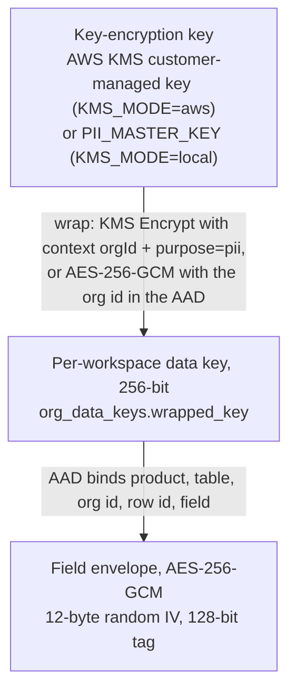

# Security architecture

This page describes the security controls in Euron Open HRMS as implemented, with the file
that implements each one, and ends with a checklist for operators. The STRIDE analysis and
residual risks are in [threat-model.md](threat-model.md). To report a vulnerability, follow
[SECURITY.md](../../SECURITY.md).

Contents:

1. [Authentication](#authentication)
2. [Authorisation (RBAC)](#authorisation-rbac)
3. [Personal-data encryption](#personal-data-encryption)
4. [Document verification](#document-verification)
5. [Production boot guards](#production-boot-guards)
6. [HTTP hardening](#http-hardening)
7. [AI document extraction](#ai-document-extraction)
8. [Infrastructure](#infrastructure)
9. [Operator checklist](#operator-checklist)

## Authentication

### Tenant users

Implemented in `apps/api/src/middleware/auth.ts` and the auth service.

| Control | Implementation |
| --- | --- |
| Password hashing | bcrypt (`bcryptjs`), cost 12 |
| Password policy | 8 to 200 characters; not one of a short list of common passwords; at least two of: lowercase, uppercase, digit, symbol. Applied on change, reset, invite acceptance and operator-set passwords |
| Account lockout | 5 consecutive failures (password or 2FA code) lock the account for 15 minutes. While locked, even the correct password is refused. A successful sign-in resets the counter |
| IP rate limit | `/api/auth`, `/api/signup` and `/api/platform/auth`: `AUTH_RATE_MAX` requests (default 300) per IP per 15 minutes |
| Enumeration | Wrong email and wrong password return the same `401 Invalid email or password`; forgot-password always returns the same message |
| Two-factor | TOTP per RFC 6238 (`security/totp.ts`): SHA-1, 30 s period, 6 digits, 160-bit secret, accepts the adjacent step on each side, constant-time comparison. Enrolment requires a correct code; disabling requires the password and a code |
| 2FA challenge | After the password step a user with 2FA gets a 5-minute challenge token (`stage: "mfa"`), which `authRequired` refuses as a session |
| Trusted devices | Optional 30-day trust token after a successful 2FA step. It is bound to a fingerprint of the current TOTP secret (re-enrolling revokes every trusted device) and to `credentialsChangedAt` (a password reset revokes it) |
| Session token | JWT signed with `JWT_SECRET`, audience `tenant`, lifetime `SESSION_TTL` (default `7d`). Claims: user id, workspace id, role, employee id |
| Per-request reload | Every request reloads the user and the workspace: disabled users get 401, suspended or cancelled workspaces get `403 WORKSPACE_SUSPENDED` |
| Revocation | `credentialsChangedAt` on the user row. A token whose `iat` is older (1 s skew allowed) is rejected. It is stamped by password change, password reset, "sign out everywhere", invite acceptance and the access-revocation sweep. Change-password and sign-out-everywhere return a fresh token pinned to the new stamp, so the caller stays signed in while every other session ends |
| Account tokens | Email verification (48 h), password reset (45 min) and user invites (7 days): 256-bit random values; only the SHA-256 hash is stored; consumed by a single conditional `UPDATE ... RETURNING`, so two concurrent uses cannot both succeed (`security/tokens.ts`). A reset invalidates the user's other outstanding reset tokens and does not sign the user in |
| Token storage in the browser | `localStorage`, one key per app, so the web app and the console can be signed in side by side |

The 7-day lifetime only bounds how long a stolen token stays useful on an otherwise healthy
account. Every administrative revocation is immediate because of the per-request reload.

### Operators

Implemented in `apps/api/src/middleware/platform-auth.ts`.

| Control | Implementation |
| --- | --- |
| Identity store | `platform_admins` (no workspace) |
| Hashing | bcrypt, cost 12 |
| Session token | JWT signed with `PLATFORM_JWT_SECRET`, audience `platform`, 12 hours |
| Per-request reload | The operator row is reloaded; `DISABLED` operators get 401 |
| Two-factor | TOTP, same implementation, enrolled from the console's Security page. The first operator created by the CLI is told to enrol it |
| Initial password | `operator:create` generates a random password and prints it once; there is no operator password change in the console, so enrolling 2FA immediately matters |
| Roles | `OPERATOR` (full) and `SUPPORT` (read-mostly). Suspend, reactivate, impersonate, create workspace, admin reset, delete workspace, apply starter content and operator management require `OPERATOR` |
| Audit | Operator sign-ins and actions are written to `audit_log` and shown in the console's fleet activity feed |

### Impersonation

An `OPERATOR` can open a support session in a workspace. The API mints a tenant token for
that workspace's first active `ADMIN` user, adds the claim `imp: <operator id>`, and writes
an `IMPERSONATE` audit row in the workspace with the operator id and reason. The console
opens the web app at `/login#imp=<token>`: the token travels in the URL fragment, which
browsers never send to a server, so it stays out of access logs, proxies and `Referer`
headers. The web app shows a support banner for impersonated sessions (asserted by the
browser test `06-impersonation.spec.ts`).

## Authorisation (RBAC)

Implemented in `apps/api/src/security/rbac.ts`; guards in `middleware/auth.ts` and
`middleware/guards.ts`. A user-facing guide is [custom-roles.md](../guides/custom-roles.md).

### Permission catalogue

The complete list of permission codes, as defined in `PERMISSIONS`:

| Group | Code | Meaning |
| --- | --- | --- |
| Core | `staff.access` | Staff access (the admin and HR side of the app) |
| People | `employees.manage` | Manage employees |
| People | `onboarding.manage` | Manage onboarding and invites |
| People | `onboarding.review` | Review and approve submitted onboarding |
| Time and leave | `leave.approve` | Approve or reject leave |
| Time and leave | `leave.manage` | Manage leave types and policies |
| Time and leave | `attendance.manage` | View and regularise attendance |
| Payroll | `payroll.manage` | Run payroll and payslips |
| Payroll | `reimbursements.manage` | Approve reimbursements |
| Payroll | `vendors.manage` | Manage vendors and bills |
| Performance | `performance.manage` | Manage PIPs and appraisals |
| Performance | `wellbeing.pulse` | View the well-being pulse |
| Workplace | `documents.manage` | Manage all documents |
| Workplace | `assets.manage` | Manage assets |
| Workplace | `perks.manage` | Manage perks |
| Workplace | `aitokens.manage` | Manage AI token allowances |
| Company | `announcements.manage` | Post announcements |
| Company | `content.manage` | Manage policies, benefits, holidays |
| Company | `reports.view` | View reports and exports |
| Company | `audit.view` | View the audit log |
| Administration | `settings.manage` | Manage organisation settings |
| Administration | `users.manage` | Manage users and invites |
| Administration | `roles.manage` | Manage roles and permissions |

`"*"` is the superuser grant. It is held only by the built-in `ADMIN` role; custom roles are
filtered to valid catalogue codes, so they can never hold it.

### Built-in roles

| Role | Permissions |
| --- | --- |
| `ADMIN` | `*` |
| `HR` | Every catalogue code except `settings.manage`, `users.manage`, `roles.manage` |
| `MANAGER` | None by permission; authority over their reports comes from the reporting line (`reportsTo`) |
| `EMPLOYEE` | None; self-service on their own records |
| `VENDOR` | None; vendor self-service |

### Resolution

- A user holds a primary `role` plus optional additional `roleKeys`. Effective permissions
  are the union over all of them, resolved on every request, so edits to a role take
  effect immediately.
- A role is "staff" when it holds `staff.access` or `*`. `staffOnly` (in `guards.ts`) gates
  the HR side of most routers on that.
- `requirePermission(...codes)` passes when the user holds any one of the codes.
- **Scope.** A user's administrative powers can be limited to departments or offices
  (`scope: { scopeType: "DEPARTMENT" | "OFFICE", scopeIds }`). Superusers are always
  workspace-wide. A scope with no ids is treated as workspace-wide so a misconfiguration
  cannot lock a user out of everything. Services check `ctx.inScope(employee)` per record
  and filter lists of employee-owned records (payslips, claims, exports) to in-scope
  employees. A user cannot change their own scope.
- **Last administrator.** Disabling, demoting or removing roles from the last user holding
  `*` is refused, and the access-revocation sweep skips that user.

Where each code is enforced today is listed in
[custom-roles.md](../guides/custom-roles.md#where-each-permission-is-enforced). Several
codes are catalogued for the role editor while their areas are still gated by
`staff.access`; read that table before relying on a narrow custom role.

## Personal-data encryption

Implemented in `apps/api/src/security/pii.ts` and applied inside the scoped store
(`repositories/base.repository.ts`): fields are sealed on every write and opened on every
read, so services always see plaintext and Postgres only ever holds ciphertext for them.
[ADR 0005](adr/0005-pii-envelope-encryption.md) records the design decision.

### What is sealed

`ENCRYPTED_FIELDS`:

| Table | `data` field | Contains |
| --- | --- | --- |
| `employees` | `kyc` | National ID (Aadhaar is stored in full because PF and ESIC filing need it), tax ID, passport, driving licence, voter ID, pension and insurance numbers |
| `employees` | `bank` | Account number, IFSC or routing code, bank name |
| `onboarding_cases` | `sections` | A candidate's onboarding answers before HR maps them onto the employee record (the same identifiers) |
| `vendors` | `bank` | Vendor bank details |

Each listed field's whole value (object, array or scalar) becomes one envelope
`{ "$enc": "v1", iv, ct, tag }`. Hot columns can never be listed: they are queried in SQL.

### Key hierarchy

| Property | Detail |
| --- | --- |
| Data keys | One per workspace, generated on first use from the CSPRNG. Two tasks racing to create it converge on one row (`ON CONFLICT DO NOTHING`, the loser adopts the winner's key) |
| Wrapping on AWS | `kms:Encrypt` / `kms:Decrypt` with `EncryptionContext {orgId, purpose: "pii"}`. The task role's KMS grant is conditioned on `kms:EncryptionContext:purpose = pii`, so the role cannot use the key directly for anything else |
| Wrapping locally | AES-256-GCM under `PII_MASTER_KEY` (32 bytes, base64). Without it, a key derived from a committed development seed is used; production refuses to boot in that state |
| Plaintext key lifetime | In process memory only, cached for 10 minutes (`DATA_KEY_CACHE_MS`), so KMS sees about one Decrypt per workspace per task per window |
| Binding | The GCM additional data names product, table, workspace, row id and field. A ciphertext copied into another row, field or workspace fails authentication (unit-tested) |
| Legacy rows | Plaintext values written before encryption are read as-is and sealed the next time the row is saved; no backfill |
| Crypto-shredding | `shredDataKey(orgId)` deletes the workspace's key row; workspace purge calls it. Every sealed field, including copies in older backups, becomes unreadable |
| Who may read | Not decided here. Route and service checks (staff access, department or office scope, the employee themselves) decide who sees decrypted values |

What is not sealed: other `data` fields (names, contact details, salary figures, leave and
attendance records), password hashes and TOTP secrets in `users.data`, and files in the
documents bucket (those are encrypted at rest by S3 with the deployment's KMS key).

## Document verification

Implemented in `apps/api/src/security/verification.ts`; public endpoint `GET /api/verify/:code`.

Every payslip, offer letter, relieving letter, experience certificate, appraisal letter,
termination letter, confirmation letter, probation extension letter, ID card and signed
document carries a code, a URL (`<APP_WEB_URL>/verify/<code>`) and a QR code of that URL.

| Property | Detail |
| --- | --- |
| Code | 12 Crockford base32 characters (no I, L, O, U) from CSPRNG bytes, grouped `XXXX-XXXX-XXXX`: 60 bits, so the endpoint cannot practically be enumerated |
| Content binding | A SHA-256 digest over the document's facts (keys sorted, values stringified) is stored with `HMAC-SHA256(DOC_VERIFY_SECRET, code + "." + digest)` |
| Checks | Unknown code: `NOT_FOUND`. Stored HMAC mismatch (row edited in the database): `TAMPERED`. A `digest` query parameter that differs from the issued one (the copy in hand was altered): `TAMPERED`. Revoked: `REVOKED`. Past `validUntil` (ID cards): `EXPIRED`. Otherwise `VALID` |
| Disclosure | Issuer, subject name and code, kind and issue date. Facts such as amounts are shown only when the issuer listed them in `disclose` for that document |
| Rate limit | 30 requests per minute per IP |
| Storage | `auth_tokens` rows of type `DOC_VERIFY`, expiring 2999-12-31, so a letter still verifies years later |

`DOC_VERIFY_SECRET` is a separate secret from the session secrets, and rotating it makes
every previously issued document report `TAMPERED` (see
[operations.md](../guides/operations.md#secret-rotation)).

## Production boot guards

`apps/api/src/core/config.ts`, called first in `index.ts`. With `NODE_ENV=production` any
problem stops the process with a list of what is wrong. In any other environment the same
checks only print a warning (and are silent under `NODE_ENV=test`).

### `assertSecrets`

| Check | Failure message (abridged) |
| --- | --- |
| `JWT_SECRET`, `PLATFORM_JWT_SECRET`, `DOC_VERIFY_SECRET` are set | `<KEY> is not set` |
| None of them is its committed `change-me-*` development default | `<KEY> is still the committed default` |
| Each is at least 32 characters | `<KEY> is too short` |
| The three values are all different | `JWT_SECRET, PLATFORM_JWT_SECRET and DOC_VERIFY_SECRET must all be different values` |
| Key scheme: with `KMS_MODE=aws` (or `kms`), `KMS_KEY_ID` is set | `KMS_MODE=aws but KMS_KEY_ID is not set` |
| Key scheme: otherwise `PII_MASTER_KEY` is set | `PII_MASTER_KEY is not set` |
| ... and decodes to exactly 32 bytes | `PII_MASTER_KEY must decode to exactly 32 bytes` |
| `CORS_ORIGINS` is not empty | `CORS_ORIGINS is not set` |

When `KMS_MODE` is unset, the scheme is `aws` if `KMS_KEY_ID` is set and `local` otherwise.

### `assertEmailFlow`

| Check | Why |
| --- | --- |
| `APP_WEB_URL` (or `APP_BASE_URL`) is set, absolute `http(s)`, and not `localhost` or `127.0.0.1` | Verify, reset and invite links must reach real users |
| The resolved `PORTAL_URL` (falls back to `APP_WEB_URL`) is not localhost | Onboarding and welcome links |
| `MAIL_MODE` is not `outbox` | Outbox writes `.eml` files to disk and delivers nothing |
| `MAIL_MODE=smtp` has `SMTP_HOST`, `SMTP_USER` and `SMTP_PASS` | Incomplete SMTP fails at first send |
| `MAIL_MODE=ses` has `SES_REGION` or `AWS_REGION` | |
| `MAIL_MODE=ses` has neither `SES_ENDPOINT` nor `AWS_ENDPOINT_URL` | An emulator endpoint would swallow production mail |
| `MAIL_MODE` is one of `outbox`, `smtp`, `ses` | |
| `MAIL_FROM` is set | A verified sender is required |

### `assertStorage`

| Check | Why |
| --- | --- |
| `STORAGE` is not `local` (and is treated as `local` when unset, for this check) | Container disks are ephemeral: documents would vanish on the next deploy |
| `STORAGE=s3` has `S3_BUCKET` | |
| `STORAGE=s3` has `S3_REGION` or `AWS_REGION` | |
| `STORAGE` is `local` or `s3` | A typo must not silently downgrade to disk |

Production must therefore set `STORAGE=s3` explicitly. Bucket credentials are not checked
at this point (on ECS they come from the task role); instead, after boot the API calls
`HeadBucket` and logs `FILE STORAGE NOT USABLE` with a specific hint if it fails.

Separately, the demo seed refuses to run with `NODE_ENV=production`.

## HTTP hardening

Configured in `apps/api/src/app.ts`.

| Control | Detail |
| --- | --- |
| Security headers | `helmet()` with its defaults; asserted by `security.int.test.ts` |
| CORS | `CORS_ORIGINS` is a comma-separated allowlist. A browser `Origin` not on it gets `403` with code `CORS_ORIGIN_DENIED` (not a 500). Requests with no `Origin` (curl, server-to-server) pass. When the list is empty CORS is open, which production refuses at boot |
| Proxy trust | `trust proxy` is `TRUST_PROXY` (default 1 hop), so per-IP rate limits and audit IPs use the real client address. Terraform sets 2 when CloudFront is in front |
| Body limit | JSON bodies up to 5 MB |
| Rate limits | Credentials (`/api/auth`, `/api/signup`, `/api/platform/auth`): `AUTH_RATE_MAX` per 15 min (default 300). Public onboarding: `ONBOARDING_PUBLIC_RATE_MAX` per 15 min (default 300). Public verification: 30 per minute |
| Error handler | `HttpError` returns its status, message and machine-readable `code`. Client errors from the body parser and uploads keep their 4xx. Anything else is a 500 with the body `{"error": "Server error", "requestId": ...}`: the message of an unexpected error is never echoed, because it can carry SQL, paths or hostnames |
| Request logging | `pino-http` with a request id; health checks are not logged. Redacted: `authorization` and `cookie` headers; any `password`, `newPassword`, `currentPassword`, `passwordHash`, `token`, `mfaToken`, `trustToken`, `mfaSecret`, `mfaPending` property; `req.body.code`. The onboarding token in `/api/onboarding/public/<token>` paths is replaced with `[redacted]` |
| CSV exports | Cells starting with `=`, `+`, `-`, `@`, a tab or a carriage return are prefixed with a single quote (`core/csv.ts`), so employee-controlled text cannot run as a spreadsheet formula |
| Error tracking | Optional Sentry (`SENTRY_DSN`, only if `@sentry/node` is installed); otherwise structured logs only |
| Health | `/up` is registered before every middleware so health checks are never throttled |

## AI document extraction

`apps/api/src/integrations/ai/document-extract.ts` can read fields out of an uploaded
identity document (PAN, Aadhaar, voter ID, passport, driving licence, bank proof,
education and experience certificates) so HR confirms values instead of retyping them.

| Rule | Detail |
| --- | --- |
| Off by default | Nothing is sent anywhere unless `AI_DOC_EXTRACTION=true` and the chosen provider's key is present |
| Explicit provider | `AI_DOC_PROVIDER` defaults to `gemini`. OpenAI is used only when `AI_DOC_PROVIDER=openai` is set; a stray `OPENAI_API_KEY` in the environment never reroutes documents |
| Per-type exclusion | `AI_DOC_EXCLUDE` (comma-separated categories, for example `AADHAAR`) keeps those document types away from any model |
| Size limit | `AI_DOC_MAX_BYTES` (default 8 MB) |
| Logging | Raw model responses are never logged |
| Trust | Results are advisory: every field is validated (for example the Aadhaar Verhoeff checksum, PAN and IFSC formats), given a confidence, and still requires HR verification |
| Endpoints | Overridable (`AI_DOC_GEMINI_BASE_URL`, `AI_DOC_OPENAI_BASE_URL`) for a gateway you operate; the test suite uses this for a local stub |

Enabling it sends document images to a third party. Decide it per deployment, and use
`AI_DOC_EXCLUDE` for the categories your jurisdiction restricts.

## Infrastructure

Provisioned by `infra/terraform/modules`.

| Area | Control |
| --- | --- |
| Network | Tasks and the database run in private subnets with no public IPs. Only the ALB is public. The VPC's default security group allows nothing. VPC flow logs (all traffic) go to an encrypted log group. S3 traffic uses a gateway endpoint; `aws-prod` adds interface endpoints for KMS and Secrets Manager |
| Security groups | One per service: ingress only from the ALB's group, egress only HTTPS and (for the API and migrate task) the database port. The database group accepts only those application groups, never a CIDR |
| Edge | HTTP redirects to HTTPS; HTTPS listener policy `ELBSecurityPolicy-TLS13-1-2-2021-06`; invalid header fields dropped; unknown hosts get a 404. With `enable_cdn`, the ALB accepts traffic only from CloudFront's origin-facing prefix list, so the WAF cannot be bypassed |
| WAF (with `enable_cdn`) | AWS managed common rule set (body size rule set to count, because uploads exceed 8 KB), known-bad-inputs rule set, and a per-IP rate rule (2000 requests per 5 minutes by default) |
| KMS | One customer-managed key with annual rotation encrypts the bucket, RDS storage, Performance Insights, the RDS master secret, the app secret, ECR repositories and CloudWatch log groups. Key policy: account root plus CloudWatch Logs for this account's log groups; all usage is granted per role through IAM |
| Bucket | Private (all four public-access blocks), bucket-owner-enforced ownership, versioned, SSE-KMS with bucket keys, and a policy denying any request without TLS |
| Database | PostgreSQL 16, encrypted with the key, `rds.force_ssl=1`, not publicly accessible, master password generated and rotated by RDS in Secrets Manager, Performance Insights and Enhanced Monitoring on, `idle_in_transaction_session_timeout` 60 s |
| DB credentials in the app | No password in the environment: the API reads it from the RDS-managed secret per new connection (cached 60 s), with TLS (`DB_SSL=require`) |
| Application secrets | Generated by Terraform (64 characters, three distinct values), stored in Secrets Manager, injected by ECS at task start. Terraform ignores later changes so out-of-band rotation is not rolled back |
| Task roles | API task role: `s3:GetObject/PutObject/DeleteObject` on the bucket's objects and `s3:ListBucket` on the bucket; `kms:Encrypt/Decrypt` only with `purpose=pii` context; `kms:GenerateDataKey/Decrypt` only via S3; `secretsmanager:GetSecretValue` on the DB secret and `kms:Decrypt` only via Secrets Manager; `ses:SendEmail/SendRawEmail` and the five SES identity actions needed for workspace sending domains. Execution roles may read only the secrets their service injects |
| Containers | Non-root `node` user, read-only root filesystem, `tini` as PID 1, ECS Exec disabled |
| Images | ECR with immutable tags, scan on push, KMS encryption, lifecycle expiry |
| Mail | SES configuration set with TLS required for delivery, suppression of bounces and complaints, and reputation metrics. It is attached to the platform identity by Terraform, and to every workspace identity the API creates when `SES_CONFIGURATION_SET` is set (Terraform sets it) |

## Operator checklist

Before you put real employee data into a deployment:

- [ ] `NODE_ENV=production` on the API, so the boot guards are enforced, not advisory.
- [ ] `JWT_SECRET`, `PLATFORM_JWT_SECRET`, `DOC_VERIFY_SECRET` are long, random and
      distinct (Terraform generates them; do not replace them with shorter values).
- [ ] `KMS_MODE=aws` with a customer-managed key, or, off AWS, a `PII_MASTER_KEY` kept in a
      secret store and backed up. Losing it loses every sealed field.
- [ ] `CORS_ORIGINS` lists exactly your web app and console origins.
- [ ] `STORAGE=s3` and the boot log shows `file storage ready`.
- [ ] `MAIL_MODE=ses` (or `smtp`) and `MAIL_FROM` on a verified identity; your SES account
      is out of the sandbox.
- [ ] The first operator has enrolled TOTP. Every operator account has 2FA; use `SUPPORT`
      for anyone who does not need destructive actions.
- [ ] Workspace admins have enrolled 2FA (it is per user and not enforced by the product).
- [ ] Decide on AI document extraction deliberately. If enabled, set `AI_DOC_EXCLUDE`.
- [ ] `aws-prod` settings, or equivalent: Multi-AZ database, deletion protection, backup
      retention that matches your obligations, CloudFront with WAF.
- [ ] Terraform state in a private, versioned, encrypted bucket with restricted access (it
      contains the generated secrets).
- [ ] An alarm email is subscribed and confirmed (`alarm_email`).
- [ ] You have a written procedure for workspace deletion that covers bucket objects and
      backups ([multi-tenancy.md](multi-tenancy.md#deleting-a-workspace)).
- [ ] You know the effect of rotating each secret before you rotate one
      ([operations.md](../guides/operations.md#secret-rotation)).
