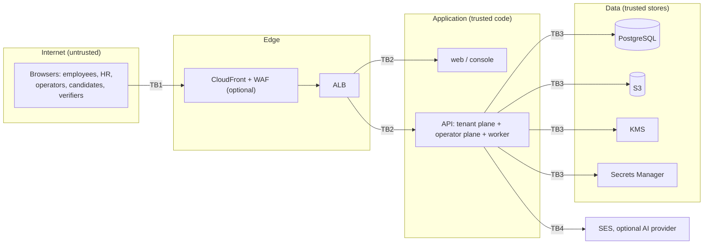

# Threat model

This is a STRIDE analysis of Euron Open HRMS as deployed by the Terraform in
`infra/terraform` (an `aws-prod`-shaped environment) with the defaults in the code. Each
row names the threat, the control that exists today, and what remains. The controls
themselves are described in [security.md](security.md); tenant isolation in
[multi-tenancy.md](multi-tenancy.md).

Residual risks are stated plainly. Where the residual is "accepted" it is a design choice;
where it is "open" it is a known gap.

## Scope and trust boundaries

| Boundary | Crossing |
| --- | --- |
| TB1 | Public internet to the edge: every request is untrusted |
| TB2 | Edge to tasks: TLS terminates at the ALB; tasks are in private subnets |
| TB3 | API to its stores: IAM task role, security groups, TLS to RDS |
| TB4 | API to third parties: SES always, an AI provider only when enabled |
| Logical | Workspace to workspace inside the tenant plane; tenant plane to operator plane |

## Assets, ranked

| Rank | Asset | Why it ranks here |
| --- | --- | --- |
| 1 | National IDs, tax IDs, passports and bank accounts (`employees.kyc`, `employees.bank`, `vendors.bank`, `onboarding_cases.sections`) | Identity theft and payment fraud; regulated data. Sealed per workspace |
| 2 | Signing secrets and key material: `JWT_SECRET`, `PLATFORM_JWT_SECRET`, `DOC_VERIFY_SECRET`, the KMS key (or `PII_MASTER_KEY`) | Each one forges sessions, operator sessions, documents, or decrypts rank 1 |
| 3 | Operator accounts and sessions | Cross-workspace authority, impersonation, suspension and permanent deletion |
| 4 | Workspace administrator accounts | Full authority over one workspace, including reading rank 1 |
| 5 | Compensation and payroll records, payslip and letter PDFs, uploaded documents | Highly sensitive; not field-sealed (database rows) and encrypted only at rest (S3) |
| 6 | Other employee records: contact details, attendance, leave, performance, well-being | Personal data |
| 7 | Integrity of issued documents (verification records) | Third parties rely on them |
| 8 | Audit log | Accountability for staff and operator actions |
| 9 | Terraform state | Contains the generated application secrets |
| 10 | Availability, especially around payroll dates | Late or wrong pay |
| 11 | Workspace sending domains and SES reputation | Spoofing, deliverability |

## Spoofing

| Threat | Mitigation | Residual |
| --- | --- | --- |
| Password guessing against a tenant account | bcrypt cost 12; 5 failures lock the account for 15 min (password and 2FA steps); IP limiter on credential endpoints; password policy | The IP limiter uses the default in-memory store, so its budget is per API task, not per deployment. Lockout can be triggered deliberately to keep a user out for 15 minutes (accepted). |
| Stolen tenant session token | 7-day expiry; per-request user and workspace reload; "sign out everywhere"; password change revokes other sessions | Tokens live in `localStorage`, readable by any script that runs in the app's origin. The Next.js apps set no Content-Security-Policy (open). |
| Brute force of the 6-digit TOTP code | Account lockout counts 2FA failures; challenge tokens expire in 5 min; window of one step either side | A code can be reused within its validity window; there is no per-code replay record (open, low). |
| Forged tenant JWT | HMAC-SHA256 with a 64-character generated secret; boot refuses default, short or shared secrets; audience `tenant` | Anyone holding `JWT_SECRET` can mint sessions for any user (see rank 2). |
| Tenant token used on the operator plane, or the reverse | Different secrets and audiences; tested in both directions | None identified. |
| Operator password guessing | bcrypt cost 12; IP limiter on `/api/platform/auth` | No per-account lockout for operators, and operator 2FA is optional (open). Enrol TOTP for every operator. |
| Exposure of the first operator's password | Generated randomly by `operator:create` and printed once | When run with `make aws-operator`, the password also lands in the one-off task's CloudWatch log group, and the console offers no operator password change (open). Enrol TOTP immediately. |
| Operator impersonation abuse | `OPERATOR` role only; reason recorded; `IMPERSONATE` audit row in the workspace; support banner in the web app | The impersonation token is a normal tenant session for the workspace's first active admin with the standard lifetime, not a short-lived one (open). |
| Phishing with spoofed workspace mail | Workspace mail leaves from its own domain only once SES reports DKIM and MAIL FROM verified; one workspace per domain; platform domain reserved; DMARC record suggested | The suggested DMARC policy is `p=none` (monitoring only); tightening it is the domain owner's decision. |
| Forged pre-hire onboarding link | Case tokens are random, stored as SHA-256 hashes, rate-limited path, masked in logs | Whoever holds the link can fill in the form (bearer token by design). |

## Tampering

| Threat | Mitigation | Residual |
| --- | --- | --- |
| Cross-workspace writes by id | Scoped repository adds `org_id` to every update and delete; isolation sweep asserts no row of another workspace changes | Application-level only; no row-level security in Postgres yet (open, roadmap). |
| Forged or altered payslip or letter | HMAC over a content digest with `DOC_VERIFY_SECRET`; verifier can pass the printed digest; revocation | A verifier who checks only the code (not the digest) confirms the code exists, not that their copy is unaltered (inherent; the digest is printed for this reason). |
| Sealed field moved between rows or workspaces | AES-GCM AAD binds table, workspace, row id and field | None identified. |
| Direct database modification by someone with DB credentials | RDS in private subnets, TLS enforced, credentials only in Secrets Manager, security groups per consumer | The API connects as the RDS master user, so a compromised task has full DDL and DML rights (open). Unsealed fields can be edited undetectably. |
| Tampered migrations | Applied migrations are checksummed; a changed file stops the runner | Anyone who can push images can ship a new migration (process control). |
| Supply-chain tampering of images | Immutable ECR tags, scan on push, lockfile installs (`--frozen-lockfile`) | No image signing (open). |
| Request tampering in transit | TLS at the ALB (TLS 1.2+ policy), HTTP redirected; with CDN, TLS 1.2_2021 minimum at CloudFront and HTTPS-only to the origin | ALB to task traffic is plain HTTP inside private subnets (accepted). |

## Repudiation

| Threat | Mitigation | Residual |
| --- | --- | --- |
| Staff deny an action | `audit_log` rows for sensitive actions (roles, users, scope, sending domains, payroll settings, onboarding) with the acting user | Not every write is audited; coverage is per feature. |
| Operator denies an action | Operator logins, suspend, reactivate, impersonate, export, admin reset, delete and operator management are audited; `TENANT_DELETE` is written without an `org_id` so it survives the purge | The audit log lives in the same database, writable by the same role; it is not append-only or tamper-evident (open). |
| Disputed payroll figures | Hand-entered amounts are marked `overridden` on the payslip; preview and commit share one computation | n/a |
| Missing request trace | Structured logs with a request id; 500 responses return the `requestId` | ALB access logs are opt-in (`alb_access_logs_bucket`); CloudFront and WAF logging are not configured by the modules (open). |

## Information disclosure

| Threat | Mitigation | Residual |
| --- | --- | --- |
| Cross-workspace reads by id | Scoped repository; isolation sweep over every parameterised route | As for tampering. |
| Leaked database dump or backup | Rank 1 fields sealed per workspace with KMS-wrapped keys; RDS storage and snapshots encrypted | Rank 5 and 6 data is readable by anyone who can read the database (field sealing covers only rank 1). |
| Data remaining after workspace deletion | Rows deleted; data key destroyed (crypto-shredding covers sealed fields in backups) | Bucket objects and the workspace's SES identity are not removed; unsealed fields remain in backups until retention expires (open, documented). |
| Over-broad staff access | Permissions per request; department and office scope; last-admin guard | Several catalogued permissions are not yet enforced separately from `staff.access` (see [custom-roles.md](../guides/custom-roles.md#where-each-permission-is-enforced)) (open). |
| Secrets in logs | pino redaction of auth headers, passwords, tokens and MFA fields; onboarding tokens masked in URLs; raw AI responses never logged | Redaction is by field name; a new field carrying a secret under another name would be logged (process control). |
| Error messages leak internals | 500 responses never echo the message | None identified. |
| Public verification reveals personal data | Default disclosure is issuer, name, kind and date; amounts only when opted in per document; 60-bit codes; 30 requests per minute per IP | Holder name and issuer are disclosed to anyone with the code (by design). |
| Identity documents sent to an AI vendor | Off by default; explicit provider; per-type exclusion | When enabled, document images leave the deployment (accepted per deployment). |
| Workspace export file | Operator-only, audited | It contains decrypted sealed fields; once downloaded it is outside every control here. |
| Terraform state exposure | Remote state guidance: private, versioned, encrypted bucket | Local state on a laptop holds the secrets in plaintext (operator responsibility). |

## Denial of service

| Threat | Mitigation | Residual |
| --- | --- | --- |
| Request floods | WAF per-IP rate rule (2000 per 5 min) with CloudFront; per-task rate limits on credential, onboarding and verification paths; autoscaling | Without `enable_cdn` there is no WAF (the `aws-dev` default). |
| Large uploads | JSON body limit 5 MB; multer limits on upload routes | n/a |
| Job queue starvation or poison jobs | Bounded retries with backoff; stuck-job reaper; unknown types left for a capable worker | A handler that loops forever holds one worker slot until the task restarts. |
| Database connection exhaustion | Pool of `PG_POOL_MAX` per task; alarm at 80 percent of the configured ceiling | The ceiling in the alarm (200) is a module input, not read from the instance; size it per instance class. |
| Duplicate sweeps across tasks | Advisory locks: one leader per sweep | n/a |
| Account lockout as a weapon | 15-minute lock, then automatic unlock | See spoofing. |

## Elevation of privilege

| Threat | Mitigation | Residual |
| --- | --- | --- |
| Employee calls staff endpoints | `staffOnly` and `requirePermission` guards; services check ownership and scope per record | Coverage depends on each route's guard; the isolation sweep tests workspaces, not roles within a workspace. The integration suites include authorisation tests per feature. |
| Custom role grants superuser | Custom roles are filtered to catalogue codes; `*` is not a catalogue code | None identified. |
| User widens their own scope | Users cannot change their own scope; scope changes need `users.manage` and are audited | An administrator with `users.manage` can grant any role, by design. |
| `SUPPORT` operator performs destructive actions | `requireOperatorRole("OPERATOR")` on every destructive route; tested | n/a |
| Compromised API task abuses KMS | Task role may use the key only with `purpose=pii` context or via S3 / Secrets Manager | A compromised task can still decrypt every workspace's data key (it must, to serve requests). |
| Container escape or persistence | Non-root user, read-only root filesystem, no public IP, ECS Exec disabled | Standard Fargate isolation is relied upon (accepted). |
| Deleting the last administrator to orphan a workspace | Last-admin guard on disable, demote and role removal; access sweep skips the only admin | n/a |

## Review triggers

Revisit this document when any of these change: a new public (unauthenticated) route, a
new table holding identifiers, a new third-party integration, a change to token lifetimes
or storage, adding row-level security, or a new operator capability.
