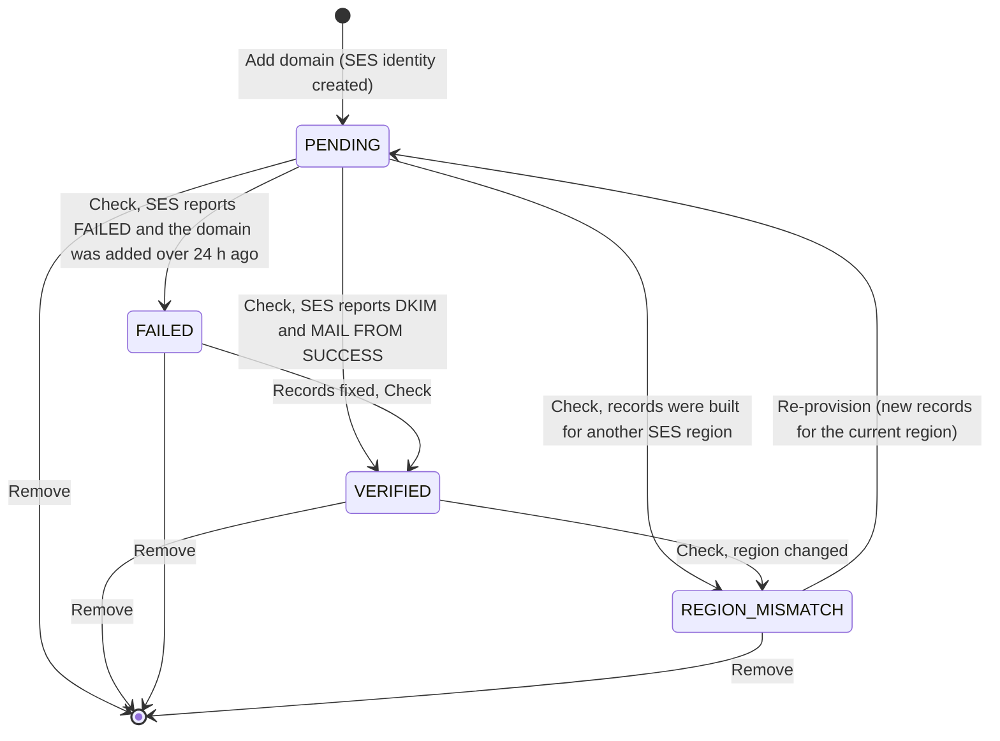

# Workspace sending domains

By default every email a workspace sends (invitations, password resets, onboarding requests,
payslips) leaves from the platform address in `MAIL_FROM`. A workspace can instead send from
its own domain, for example `hr@mail.acme.example.com`, after proving ownership through DNS.
Amazon SES is the source of truth for verification; the API never decides on its own that a
domain is verified.

Domains are provisioned and verified in SES, so the feature is designed for deployments that
send with `MAIL_MODE=ses`. The settings page and every endpoint below require the
`settings.manage` permission.

## Rules

| Rule | Behaviour |
| --- | --- |
| One domain per workspace | A second domain is refused until the first is removed. Adding the same domain again is idempotent |
| One workspace per domain | SES identities are account-wide, so a domain held by another workspace is refused with `409 EMAIL_DOMAIN_TAKEN`. Without this, a second workspace could see the other's identity as `VERIFIED` and send as it |
| Platform domain reserved | The domain of `MAIL_FROM` cannot be added (`409 EMAIL_DOMAIN_TAKEN`) |
| Subdomain recommended | An apex domain (two labels, such as `example.com`) is accepted with a warning; a subdomain such as `mail.example.com` isolates reputation and avoids colliding with existing SPF and DMARC records |
| Test sends go to you | The test email always goes to the signed-in admin's own address, never to an address in the request, so the feature cannot be used as a relay |

## Lifecycle



### 1. Add the domain

Settings, Sending domain, enter the domain, Add (`POST /api/email-domain {"domain": ...}`).
The API:

1. validates and normalises the domain;
2. refuses the platform domain and any domain another workspace holds;
3. creates the SES identity with Easy DKIM (RSA 2048), tagged `app=open-hrms`, with the
   configuration set in `SES_CONFIGURATION_SET` when that is set (Terraform sets it, so
   workspace mail gets the same TLS requirement and bounce and complaint suppression as
   platform mail);
4. sets a custom MAIL FROM domain `bounce.<domain>`, rejecting mail if its MX record is
   missing;
5. stores the record set, the SES region it was built for and status `PENDING` in the
   workspace (`organizations.data.emailDomain`), and writes an `EMAIL_DOMAIN_ONBOARD` audit
   entry.

### 2. Publish the DNS records

The settings page lists the records with copy buttons. For a domain `mail.acme.example.com`
in `us-east-1`:

| Type | Name | Value | Purpose |
| --- | --- | --- | --- |
| `CNAME` (3 records) | `<token>._domainkey.mail.acme.example.com` | `<token>.dkim.amazonses.com` | DKIM |
| `MX` (priority 10) | `bounce.mail.acme.example.com` | `feedback-smtp.us-east-1.amazonses.com` | MAIL FROM |
| `TXT` | `bounce.mail.acme.example.com` | `v=spf1 include:amazonses.com ~all` | SPF for MAIL FROM |
| `TXT` | `mail.acme.example.com` | `v=spf1 include:amazonses.com ~all` | SPF for the sending domain |
| `TXT` | `_dmarc.mail.acme.example.com` | `v=DMARC1; p=none; rua=mailto:dmarc-reports@mail.acme.example.com` | DMARC (monitoring policy) |

TXT values are shown without surrounding quotes. Hosted DNS managers add their own quoting;
pasting a pre-quoted value publishes doubled quotes, which fails verification without a
useful error. If a DMARC record already exists for the domain, the API returns it
(`existingDmarcTxt`) so you can keep your own policy rather than replace it.

The MX value names an SES region. Records issued for one region can never verify an
identity in another (see `REGION_MISMATCH` below).

### 3. Check verification

Check verification (`POST /api/email-domain/check`) asks SES for the identity's DKIM and
MAIL FROM status:

| SES reports | New status |
| --- | --- |
| DKIM `SUCCESS` and MAIL FROM `SUCCESS` | `VERIFIED`; `verifiedAt` recorded; `EMAIL_DOMAIN_VERIFIED` audited once |
| Either `FAILED`, and the domain was added more than 24 hours ago | `FAILED`, with "DNS records have been missing or incorrect for over 24 hours." |
| Anything else | Unchanged: `PENDING` (or `VERIFIED` if it already was) |

On AWS, SES verifies asynchronously after DNS propagates; the settings page tells admins to
allow 5 to 60 minutes. Click Check again rather than removing and re-adding the domain.

**From address.** The moment a domain first verifies, the API sets the From address to
`hr@<domain>` and the From name to the workspace name, unless one was already set. Admins
can change it in the From address card (`PUT /api/email-domain/sender
{"fromAddress", "fromName", "replyTo"}`); the address must be on the verified domain.

### 4. How the sender is chosen

For every message on behalf of a workspace:

1. **Verified domain with a From address**: `<From name> <fromAddress>`, with the configured
   Reply-To.
2. Otherwise, if the workspace set a sender display name: `<that name> <platform address>`.
3. Otherwise: the platform `MAIL_FROM`.

When the workspace's own domain is not used, the reason is logged with the send
(`senderFallback`: `NO_DOMAIN`, `NOT_VERIFIED` or `NO_FROM_ADDRESS`) and shown on the settings
page, which always states the address mail is actually sent from. A send that fails is
logged as `email send failed` and never breaks the action that triggered it.

### 5. Send a test

Send test email (`POST /api/email-domain/test`) sends to your own address through the
resolved sender and reports the From address used, whether it was the workspace's own
domain, the mail mode, whether it was delivered and any error. It is audited as
`EMAIL_DOMAIN_TEST`.

### 6. Remove

Remove (`DELETE /api/email-domain`) deletes the SES identity (a missing identity is not an
error), clears the workspace record and audits `EMAIL_DOMAIN_DELETE`. Mail reverts to the
platform sender immediately. Remove a workspace's domain before purging the workspace: the
purge does not delete SES identities.

### Region mismatch

If the SES region (`SES_REGION`, else `AWS_REGION`) changes after records were issued, Check
refuses to answer across the boundary and sets `REGION_MISMATCH`, naming both regions.
Records created before the region was stored are matched by the region inside their MX
value. Re-provision (`POST /api/email-domain/reprovision`) creates the identity in the
current region, issues new records and resets to `PENDING`, keeping the From address,
From name and Reply-To. Publish the new records, then Check.

## What admins see

| Element | Shows |
| --- | --- |
| Status badge | `PENDING`, `VERIFIED`, `FAILED` or `REGION_MISMATCH`, with DKIM and MAIL FROM status |
| "Emails are sent from" | The effective From line; if it is not the workspace's domain, the reason in plain words |
| Outbox notice | Shown when the server runs `MAIL_MODE=outbox`: messages are written to disk, not delivered |
| Region notice | For `REGION_MISMATCH`, with a Re-provision button |
| Apex warning | For two-label domains, recommending `mail.<domain>` |
| DNS records table | Type, name, value and priority, each copyable |
| From address card | Once `VERIFIED`: From address, From name, Reply-To |

## Trying it on the emulator

The local stack (`make up`) runs SES on the Floci emulator, which verifies an identity only
once its DKIM `CNAME` records exist in the emulator's Route53, as AWS does with real DNS. To
verify a domain locally, play the DNS administrator against the emulator:

```bash
export AWS_ACCESS_KEY_ID=test AWS_SECRET_ACCESS_KEY=test AWS_REGION=us-east-1
EP=http://localhost:4576
DOMAIN=mail.acme.example.com

# 1. Add DOMAIN in Settings, Sending domain (as a workspace admin).
# 2. Create a hosted zone for it in the emulator:
ZONE=$(aws --endpoint-url $EP route53 create-hosted-zone --name $DOMAIN \
  --caller-reference "$(date +%s)" --query 'HostedZone.Id' --output text)

# 3. Publish each record from the settings page. One DKIM record as an example:
aws --endpoint-url $EP route53 change-resource-record-sets --hosted-zone-id "$ZONE" --change-batch '{
  "Changes": [{ "Action": "UPSERT", "ResourceRecordSet": {
    "Name": "<token>._domainkey.mail.acme.example.com", "Type": "CNAME", "TTL": 300,
    "ResourceRecords": [{ "Value": "<token>.dkim.amazonses.com" }] } }] }'
```

Repeat for the other two DKIM records, the `MX` (value `10 feedback-smtp.us-east-1.amazonses.com`)
and the `TXT` records (in the Route53 API, TXT values are wrapped in double quotes). Then click
Check verification: on the emulator the status settles within seconds. Send a test email and
open it in Mailpit at <http://localhost:8025>.

## How it is tested

`apps/api/test/integration/sending-domains.int.test.ts` runs the whole lifecycle against SES on
the emulator whenever the suite runs with `MAIL_MODE=ses` and an `AWS_ENDPOINT_URL` (the `ses`
rows of `make test-matrix`). It creates a delegated Route53 zone for a fresh subdomain and
asserts that:

1. adding the domain creates the SES identity and returns the records, including three DKIM
   records and the `bounce.` MX;
2. while unverified, a test email is delivered from the platform address, not the new domain;
3. a check before the records exist stays `PENDING`;
4. after the test publishes the records, the check reaches `VERIFIED` (polling once a second,
   up to 30 times) and adopts `hr@<domain>`;
5. mail then leaves from the workspace's own domain, read back from Mailpit;
6. another workspace keeps sending from the platform address;
7. a second workspace cannot claim the same domain;
8. removing the domain deletes the SES identity and reverts to the platform sender.

The test removes its records and zone afterwards, leaving the emulator as it found it.
